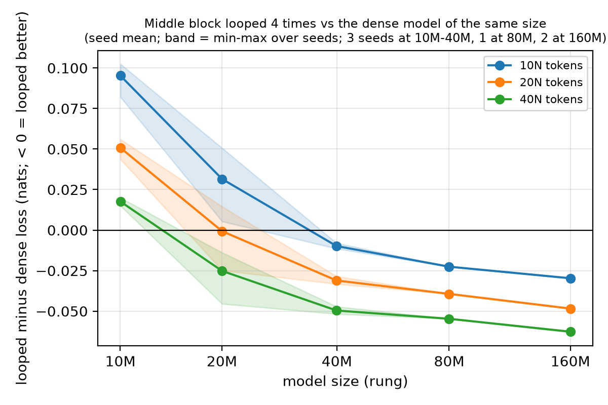
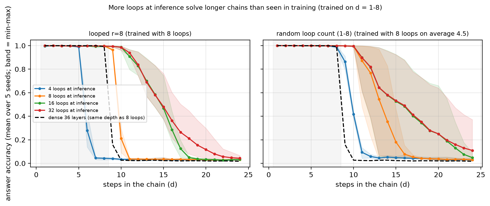

# How much is a loop worth?

**A pre-registered scaling study of looped (recurrent-depth) transformers from 10M to 160M parameters**

**Technical report: [English](docs/report.md) · [中文](docs/report.zh.md)**

> **Status (2026-10-12).** All experiments are complete: 111 pre-registered training runs plus extensions, about 200
> language models in total and about 80 small models on a synthetic reasoning task. The technical report is a draft and
> a paper is in preparation. Results marked *exploratory* were not part of the pre-registration.

A looped transformer runs one block of layers *r* times. It pays *r* times the compute of that block and adds no
parameters. We trained models of 10M to 160M parameters under a single recipe to measure what the extra compute buys,
and when it is worth paying.

## Key findings for practitioners

| If you want to… | What we found |
|---|---|
| **Save parameters or memory** | Loops help, and more so at larger sizes. At equal parameters and training tokens, a middle block looped 4 times goes from 0.10 nats *worse* than a dense model at 10M to 0.03–0.06 nats *better* at 160M, and the gain grows at every step up in size (Figure 12). |
| **Get more out of limited data** | Loops help more the longer you train: each doubling of tokens per parameter adds 0.02–0.03 nats. At 160 tokens per parameter a 10M looped model matches a dense model trained on 1.7× as much data (Figure 11). |
| **Save training compute** | Don't loop. At equal training FLOPs the dense model won all 320 comparisons. A middle block looped r = 2, 4, 8 times costs 1.4–1.5×, 2.2–2.4×, 3.7–4.1× the training FLOPs per token of the same-size dense model. |
| **Get better answers by running more loops at test time, on text** | Standard training does not give you this. Models trained with a fixed loop count only work at that count. Training with a random loop count (as in Huginn) makes them robust to the count, but not better with more loops, and at 20M it erased the advantage over the dense model. |
| **Get step-by-step reasoning inside the network** | Possible, when the task needs serial steps and the model is trained for it. On chains of table lookups, looped models learned to compute one step per loop and solved longer chains than they were trained on when given more loops. Dense models of the same depth, with 4.4× the parameters, failed right after the training range (Figures 14, 15). |

### A recipe

1. **Loop a middle block** and keep the first and last layers unshared (2 + 4×*r* + 2 layers in our models). At
   matched executed depth, middle-block loops beat whole-stack loops in 24 of 24 comparisons.
2. **Use full backpropagation through the loops.** Truncated backprop accounted for 25 of the 30 runs with loss
   spikes (16 of them whole-stack loops); halving the learning rate removed the spikes in a 10M follow-up.
3. **Start with r = 4 on text, and judge at your target scale.** At 40M–80M, r = 8 did about as well as r = 4 while
   costing about 1.7× more; extra loops pay off on tasks that need more serial steps. A loop is worth more at 160M than
   at 10M and more with more tokens per parameter, so a small-scale ablation will undersell it.
4. **Tune the learning rate of the looped model separately.** On the reasoning task the best looped learning rate was
   2–8× lower than the dense one, and at the dense-optimal rate the same architecture learned a fixed-length program
   instead of an algorithm that extends to longer problems.
5. **Check what the loop learned** by sweeping the number of loops at inference. A model that only works at its
   training count has learned a fixed program; one whose accuracy holds or improves with more loops is iterating.
6. **Measure memory and latency yourself.** We report loss and FLOPs, not deployment speed, which is often the
   reason to loop in the first place.

## Results at a glance

<p align="center">
  <br>
  <em>The same looped cell against the dense model of equal size: worse at 10M, about even at 20M, better from 40M on, and the gap keeps growing to 160M.</em>
</p>

<p align="center">
  <br>
  <em>On a step-by-step task, more loops at inference solve longer chains than seen in training (trained on 1–8 steps); a dense model of the same depth does not.</em>
</p>

**On text, the loop does not reason.** Probing trained language models loop by loop, a fixed-loop model runs a
fixed-length program whose last loop rewrites the state for the output layers; truncated backprop learns a periodic
cycle; random-loop training converges to a fixed point. None gains from extra loops at inference, because predicting
web text rarely needs many serial steps.

**On a task that needs serial steps, it does.** Mean over 5 seeds (min–max):

| Model | Params | Longest chain solved* | With more loops at inference | Accuracy at 12 steps** |
|---|---|---|---|---|
| Dense, 8 layers | 6.5M | 4.2 (4–5) | — | 0.06 |
| Dense, 36 layers | 29.0M | 8.0 (8–8) | — | 0.02 |
| Looped, 8 layers × 8 loops | 6.6M | 9.0 (9–9) | 11.2 (11–12) | 0.86 |
| Looped, random loop count in training | 6.6M | 11.4 (10–13) | 12.2 (10–15) | 0.83 |
| Looped, as many loops as steps in training | 6.6M | 12.8 (11–16) | — | 0.96 |

\* every chain length up to this one solved at ≥ 90% accuracy, at the model's own loop count; trained on 1–8 steps.
\*\* best available loop count.

## The study

| | |
|---|---|
| Models | looped models at 10M, 20M, 40M and 80M (8 unique layers; a middle block or the whole stack looped r = 2, 4, 8 times; full or truncated backprop), dense models up to 160M; extensions: 160M looped, data up to 160 tokens per parameter, random loop counts, synthetic tasks |
| Data | FineWeb-Edu sample-10BT (10.4B tokens, one epoch), 16k BPE; validation on held-out FineWeb-Edu, SlimPajama, FineMath and code |
| Training | AdamW, WSD schedule with cooldown branches at 10, 20 and 40 tokens per parameter; 3 seeds at 10M–40M |
| Measurement | effective size N_eff = N_once + r^φ · N_rec, read off a dense "ruler" fit; also ruler-free loss gaps and equal-compute comparisons |
| Pre-registration | frozen on 2026-09-23 before any training run, hash recorded in the history ([how to verify](docs/preregistration.md)); every later change is dated in the [deviation log](docs/deviation-log.md) |

**Pre-registered verdicts.** None of the four hypotheses held as stated. Truncated backprop did not lower φ (it
helped whole-stack loops); a looped middle block beat the whole stack on raw losses but not consistently on φ; φ did
not saturate in *r*; and under both training and deployment compute the dense model was optimal. The pre-registered
φ itself is not identified in absolute terms (0–0.17 in the primary fit, 0.29–0.41 in a joint fit) because the dense
ruler is weakly identified, so the findings above rest on quantities that need no ruler. Details: [report](docs/report.md),
[full results](docs/results.md).

## Documents

| | |
|---|---|
| [docs/report.md](docs/report.md) · [中文](docs/report.zh.md) | **Technical report**: the whole study in one readable document, with practical takeaways |
| [docs/results.md](docs/results.md) | Full results: pre-registered fits and verdicts, robustness, and every exploratory analysis |
| [docs/preregistration.md](docs/preregistration.md) | Pre-registration v1.0 (English translation of the frozen original) and how to verify its hash |
| [docs/deviation-log.md](docs/deviation-log.md) | Every change to the plan, dated and append-only; frozen hyper-parameters, data and throughput |
| [docs/synthetic-reasoning-design.md](docs/synthetic-reasoning-design.md) | Design of the synthetic reasoning tasks (frozen 2026-10-09) |
| [docs/roadmap.md](docs/roadmap.md) | Project phases and status |

## Repository layout

```
docs/                project documents (above)
code/
  looped/            model (prelude / looped core / coda, input injection, truncated backprop), FLOP counting,
                     data stream, WSD schedule, training loop with cooldown branches, evaluation
  scripts/           data preparation, config generation, run queue, throughput measurement, result export,
                     loss-spike statistics
  fit/               scaling-law fits, H4 calculation, per-rung φ, per-token analysis, per-loop probes, figures
  synthetic/         synthetic reasoning tasks, trainer, multi-GPU suite runner, intermediate-value probes, analysis
  configs/           every run config and manifest (sweeps, main grid, extensions)
  results/           per-run results, collected tables, fits, probe outputs, figures
  tests/             unit and smoke tests
```

## Reproducing

```
cd code
uv venv --python 3.11 && source .venv/bin/activate && uv pip install -e .
python -m pytest tests -q
```

Training ran on 4× RTX 4090 with PyTorch 2.6 (CUDA 12.4), one run per GPU; the main grid took 11 days. Fits and
figures run on a laptop CPU. The full command sequence is in [code/README.md](code/README.md). Every run's results and
training log are in `code/results/`, so every number can be recomputed without retraining.

## Citation and license

A paper is in preparation; citation details will be added here. The code is released under the MIT license
(see [LICENSE](LICENSE)).
