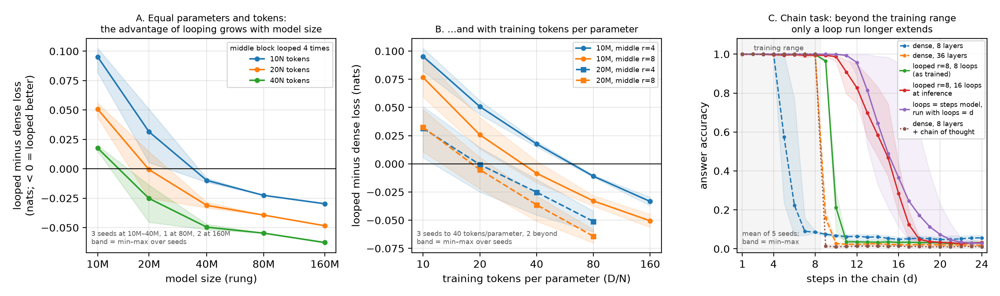

# What a loop buys: parameter efficiency on text, extendable depth on serial tasks

[](https://github.com/bethehand/looped-scaling/actions/workflows/tests.yml)

**Looped (recurrent-depth) transformers from 10M to 160M parameters: 111 pre-registered training runs, three
extension studies, a synthetic reasoning task, and nine supplementary experiments whose plans were frozen before they
ran. On web text a loop buys parameter efficiency that grows with scale and data, never compute efficiency. On a task
that needs serial steps it buys depth that can be extended at inference, and the model can tell when to stop.**

**Technical report: [English](docs/report.md) · [中文](docs/report.zh.md)** · [Full results](docs/results.md) ·
[Pre-registration](docs/preregistration.md) · [Deviation log](docs/deviation-log.md)

> **Status (2026-10-17).** All experiments are complete: 232 language models and 135 small models on the
> synthetic task, every run's results and training logs in this repository. The report covers everything; a paper is
> in preparation ([plan](docs/paper-plan.md)). Results marked *exploratory* were not part of the pre-registration;
> every correction after the two reviews (2026-10-14 and 2026-10-15) is dated in the deviation log.

<p align="center">
  <br>
  <em>A. At equal parameters and tokens the looped model goes from worse than the dense model at 10M to better from 40M on. B. The advantage grows with training tokens per parameter. C. On chains of table lookups (trained on 1–8 steps), only a loop run longer at inference solves longer chains; dense models and a written chain of thought stop at the training range.</em>
</p>

## The question

A looped transformer runs one block of layers *r* times. It pays *r* times the compute of that block and adds no
parameters. Two things are expected of it: that it behaves like a larger model (parameter efficiency), and that running
more loops at inference lets it solve harder problems without writing a chain of thought (latent reasoning). We trained
models of 10M to 160M parameters under a single recipe, with the hypotheses and the analysis frozen before the first
run, to measure what the loop buys, when it becomes reasoning, and what it costs.

## What we found

1. **On text, loops buy parameter and data efficiency, not compute efficiency.** At equal parameters and tokens, a
   middle block looped 4 times goes from 0.02–0.10 nats *worse* than the dense model at 10M to 0.03–0.06 nats *better*
   at 160M, and the advantage grows with every doubling of tokens per parameter. At equal training compute the dense
   model wins all 258 measured comparisons, now to 640 tokens per parameter; the margin shrinks with data, and with the
   looped model's own learning rate the two reach parity at 10M and 160 tokens per parameter.
2. **The pre-registered number φ is not identified in absolute terms** (0–0.17 or 0–0.41 depending on the fit), because
   the dense "ruler" is weakly identified. Measured without a ruler, a parameter of the looped block is worth 0.6–1.0
   dense parameters below about 35M and 1.26–1.46 at 40M–160M, in line with published results at 130M–1.4B. φ is not a
   constant of the architecture.
3. **None of the four pre-registered hypotheses held as stated.**
4. **On text, the loop does not iterate towards an answer**: a fixed-length program, a periodic cycle or a fixed point,
   depending on the training regime, and never a gain from extra loops at inference.
5. **On a task that needs serial steps, loops learn one step per loop, extend at inference and can stop by
   themselves.** A model trained with 8 loops goes from 0.04 to 0.86 on 12-step chains when run longer; dense models of
   the same depth with 4.4× the parameters fail right after the training range. The model's own confidence stops it
   at the right loop, recovering 97–98% of the gain; a model trained with loops = steps plus a few random extra loops
   both extends and stops (0.93 on 12-step chains).
6. **A written chain of thought did not do this here**: perfect within the training range at a third of the compute,
   chance level on every longer chain, because it fails to generalise to the longer prompts. Pause tokens add nothing.
7. **At deployment, loops cost latency and memory**: at equal loss, 14–19% less weight memory but 2.2–2.3× the KV cache
   and 2.4–2.5× the decoding time per token. Sharing the cache across loops costs the fixed-loop models two to four
   times their gain.

Underneath the seven findings is one question: when does running a block again work as test-time compute? Three
conditions separate the two settings: headroom (the errors come from too few serial steps, not from missing
knowledge), extendable iteration (the loop can run longer without destroying its state), and a stopping signal. The
chain task has all three once the model is trained for them; web text, at these sizes, shows none, and what remains
there is a parameter-efficiency gain that grows with scale and data, paid for in decoding time.

The [report](docs/report.md) gives the evidence for each; [results](docs/results.md) has every number.

## For practitioners

| If you want to… | What we found |
|---|---|
| **Save parameters** | Loops help, and more so at larger sizes and with more training tokens per parameter: 0.02–0.10 nats worse than the dense model at 10M, 0.03–0.06 nats better at 160M (Figure 12), and 0.02–0.03 nats more per doubling of tokens per parameter (Figure 11). Holds with re-tuned learning rates (S1). |
| **Save training compute** | Don't loop, within the range we measured. At equal training FLOPs the dense model won all 258 comparisons in which its loss was measured, now to 640 tokens per parameter at 10M and 320 at 20M (S4); the margin falls to 0.01–0.05 nats at the largest looped budgets, and with the looped model's own learning rate the two are at parity at 10M/160N. A middle block looped 2, 4, 8 times costs 1.4–1.5×, 2.2–2.4×, 3.7–4.1× the training FLOPs per token of the same-size dense model. |
| **Save memory or latency at deployment** | Not at these sizes. At equal loss, a middle block looped 4 times needs 14–19% less weight memory at 40M–160M but 2.2–2.3× the KV cache and 2.4–2.5× the decoding time per token, and 1.6× the peak memory at batch 32 (S3). Sharing the KV cache across loops is free only for random-loop models, whose loops gain nothing; fixed-loop models lose 0.09–0.17 nats, two to four times their gain (S6). |
| **Get better answers by running more loops at test time, on text** | Standard training does not give you this. Fixed-loop models work only at their training loop count; random-loop training (as in Huginn) makes them robust to the count but not better with more loops, and at 20M it erased the advantage over the dense model. |
| **Get step-by-step reasoning inside the network** | Possible, when the task needs serial steps and the model is trained for it. On chains of table lookups, looped models compute one step per loop and solve longer chains than trained on when given more loops; dense models fail right after the training range even at the same depth with 4.4× the parameters (Figures 14, 15). The learning rate decides whether this is learned at all (S2). |
| **Let the model decide when to stop** | Stop when its top probability reaches 0.99: this recovers 97–98% of the extra-loop gain for fixed- and random-loop models, using fewer loops than training (S8). The model trained with loops = steps extends furthest but cannot stop by its state; trained with 0–4 random extra loops it keeps its values and stops at 0.93 on 12-step chains, one step of extrapolation less (S9). |
| **Choose between loops and a chain of thought** | By the lengths you need. Within the training range a chain of thought was perfect at a third of the inference compute; beyond it only the loop extended, on this task (S5). |

### A recipe

1. **Loop a middle block** and keep the first and last layers unshared (2 + 4×*r* + 2 layers in our models). At
   matched executed depth, middle-block loops beat whole-stack loops in 24 of 24 comparisons.
2. **Use full backpropagation through the loops.** Truncated backprop accounted for 25 of the 30 runs with loss
   spikes (16 of them whole-stack loops); halving the learning rate removed the spikes in a 10M follow-up.
3. **Start with r = 4 on text, and judge at your target scale.** At 40M–80M, r = 8 did about as well as r = 4 while
   costing about 1.7× more. A loop is worth more at 160M than at 10M and more with more tokens per parameter, so a
   small-scale ablation will undersell it.
4. **Tune the learning rate of the looped model separately, especially at small scale.** On text the dense rate cost
   the looped model at most 0.006 nats at 20M–40M, but at 10M the looped model wanted 0.35–0.5× the dense rate on
   longer runs (worth 0.02 nats). On the reasoning task the best looped rate was 2–8× lower than the dense one, and at
   the dense-optimal rate 10 of 12 looped runs did not learn the task in the same number of steps (S2).
5. **Check whether the model can use more loops** by sweeping the loop count at inference. On text none of ours
   could; on the chain task, models whose accuracy held at more loops also solved longer chains with them. Probes show
   whether the loop computes step by step even when the model works only at its training loop count.
6. **Count the KV cache and the latency, not just the parameters.** With one cache per executed layer, decoding time
   and KV cache grow with the executed layers (1.5×, 2.5×, 4.5× for a middle block looped 2, 4, 8 times). Loop to save
   memory only where weights dominate it, e.g. one sequence at a time with a short context in a larger model.

## The study

| | |
|---|---|
| Models | looped models at 10M, 20M, 40M and 80M (8 unique layers; a middle block or the whole stack looped r = 2, 4, 8 times; full or truncated backprop), dense models up to 160M; extensions: 160M looped, data up to 160 tokens per parameter (640 for the dense model in S4), random loop counts |
| Data | FineWeb-Edu sample-10BT (10.4B tokens, one epoch), 16k BPE; validation on held-out FineWeb-Edu, SlimPajama, FineMath and code |
| Training | AdamW, WSD schedule with cooldown branches at 10, 20 and 40 tokens per parameter; 3 seeds at 10M–40M, 1 at 80M, 2 at 160M |
| Measurement | effective size N_eff = N_once + r^φ · N_rec (the form of Schwethelm et al., 2026), read off a dense "ruler" fit; also ruler-free loss gaps, dense sizes of equal loss, and equal-compute comparisons on the raw data |
| Synthetic task | chains of 1–8 table lookups (32 fixed random tables), tested to 24 steps; dense models of 8, 20 and 36 layers and 8-layer looped models with r = 2, 4, 8, a random loop count, loops = steps, and loops = steps plus random extra loops; chain-of-thought and pause-token baselines; 5 seeds per condition ([design](docs/synthetic-reasoning-design.md), frozen 2026-10-09) |
| Pre-registration | frozen on 2026-09-23 before any training run, hash recorded in the history ([how to verify](docs/preregistration.md)); every later change is dated in the [deviation log](docs/deviation-log.md) |
| Supplementary experiments | S1 learning rates re-tuned at 10M–40M; S2 the learning rate on the synthetic task; S3 memory and decoding latency ([plan](docs/supplementary-experiments.md), frozen 2026-10-13; [results §5.16](docs/results.md)). S4 dense models to 640 tokens per parameter; S5 chain of thought and pause tokens; S6 KV-cache sharing across loops; S7 seeds that change the data order; S8 stopping rules and voting; S9 loops = steps plus random extra loops ([plan](docs/supplementary-experiments-2.md), frozen 2026-10-15; [results §5.18](docs/results.md)). All exploratory. |
| Compute | 4× RTX 4090; main grid 11 days, extensions about 5, supplementary experiments about 3 |

**Pre-registered verdicts.** None of the four hypotheses held as stated. Truncated backprop did not lower φ (it
helped whole-stack loops); a looped middle block beat the whole stack on raw losses but not consistently on φ; a form in
which φ saturates in *r* did not extrapolate better than r^φ (the data cannot tell the two apart); and under both
training and deployment compute the dense model was optimal. The pre-registered φ itself is not identified in
absolute terms (0–0.17 in the primary fit, 0–0.41 in a joint fit) because the dense ruler is weakly identified, so the
findings above rest on quantities that need no ruler ([results §5.17](docs/results.md)).

## How this relates to other work

- The effective-parameter form N_eff = N_once + r^φ · N_rec and the layout with unshared layers before and after the
  loop follow Schwethelm et al. ([arXiv:2604.21106](https://arxiv.org/abs/2604.21106)). This study was designed to be
  comparable with theirs and adds seeds, separate variation of model size and tokens per parameter, truncated backprop
  under two accountings, and whole-stack loops. Measured without a ruler, our values at 40M–160M agree with their
  φ = 0.46 and with other published equal-parameter results restated in the same unit (1.2–1.6 dense parameters per
  parameter); below about 40M and 20 tokens per parameter a loop is worth less than its parameters, a regime the
  published studies barely sample.
- That weight-shared transformers do slightly better at equal parameters and slightly worse at equal FLOPs was already
  reported by Kaplan et al. (2020, App. D.2, [arXiv:2001.08361](https://arxiv.org/abs/2001.08361)). What this study adds
  is how the balance moves with size and data, and that it ends in parity, not a looped win, at the most data per
  parameter we could afford.
- On serial reasoning tasks, solving longer chains with more loops at test time was shown by Kohli et al.
  ([arXiv:2604.07822](https://arxiv.org/abs/2604.07822)) and Zhang et al. ([arXiv:2607.20594](https://arxiv.org/abs/2607.20594));
  our synthetic results agree with both and add equal-depth dense controls, probes of every intermediate value,
  answer-free stopping rules, and the comparison with a chain of thought.
- Related work in full, with references: [report §1](docs/report.md#related-work).

## Documents

| | |
|---|---|
| [docs/report.md](docs/report.md) · [中文](docs/report.zh.md) | **Technical report**: the whole study in one document, with a guide to reading it and practical takeaways |
| [docs/results.md](docs/results.md) | Full results: pre-registered fits and verdicts, robustness, every exploratory analysis and all nine supplementary experiments |
| [docs/preregistration.md](docs/preregistration.md) | Pre-registration v1.0 (English translation of the frozen original) and how to verify its hash |
| [docs/deviation-log.md](docs/deviation-log.md) | Every change to the plan, dated and append-only; frozen hyper-parameters, data and throughput |
| [docs/synthetic-reasoning-design.md](docs/synthetic-reasoning-design.md) | Design of the synthetic reasoning task and its predictions (frozen 2026-10-09) |
| [docs/supplementary-experiments.md](docs/supplementary-experiments.md), [-2.md](docs/supplementary-experiments-2.md) | The two supplementary plans, S1–S3 and S4–S9, frozen before their runs |
| [docs/roadmap.md](docs/roadmap.md) | Project phases and status |
| [docs/paper-plan.md](docs/paper-plan.md) | Paper plan: positioning, title candidates, claims ledger, outline, figures, schedule |

## Repository layout

```
docs/                project documents (above)
code/
  looped/            model (prelude / looped core / coda, input injection, truncated backprop), FLOP counting,
                     data stream, WSD schedule, training loop with cooldown branches, evaluation, KV-cached inference
  scripts/           data preparation, config generation, run queue, throughput and inference benchmarks,
                     result export, loss-spike statistics, KV-sharing and chain-of-thought diagnostics
  fit/               scaling-law fits, H4 calculation, per-rung φ, ruler-free multipliers, equal-compute bounds,
                     per-token analysis, per-loop probes, supplementary analyses, figures
  synthetic/         synthetic reasoning task, trainer, multi-GPU suite runner, probes, stopping rules, analysis
  configs/           every run config and manifest (sweeps, main grid, extensions, supplementary experiments)
  results/           per-run results and training logs, collected tables, fits, synthetic and supplementary
                     outputs, figures
  tests/             unit and smoke tests (135)
```

## Reproducing

```
cd code
uv venv --python 3.11 && source .venv/bin/activate && uv pip install -e ".[test]"
python -m pytest tests -q
```

Training ran on 4× RTX 4090 with PyTorch 2.6 (CUDA 12.4), one run per GPU; the main grid took 11 days. Fits and
figures run on a laptop CPU. [code/README.md](code/README.md) gives the full command sequence and maps every table and
figure to the command that makes it. Every run's results are in `code/results/runs/`, so every number can be
recomputed without retraining; the per-run training logs are in `code/results/train_logs/`.

## Citation and license

A paper is in preparation. Until then, please cite the report (also in [CITATION.cff](CITATION.cff)):

```
Qirun Li. What a loop buys: parameter efficiency on text, extendable depth on serial tasks. Technical report, 2026.
https://github.com/bethehand/looped-scaling
```

The code is released under the MIT license (see [LICENSE](LICENSE)). The analysis code, documents and text were
drafted with an AI assistant under the author's direction; every number is reproducible from the repository.
