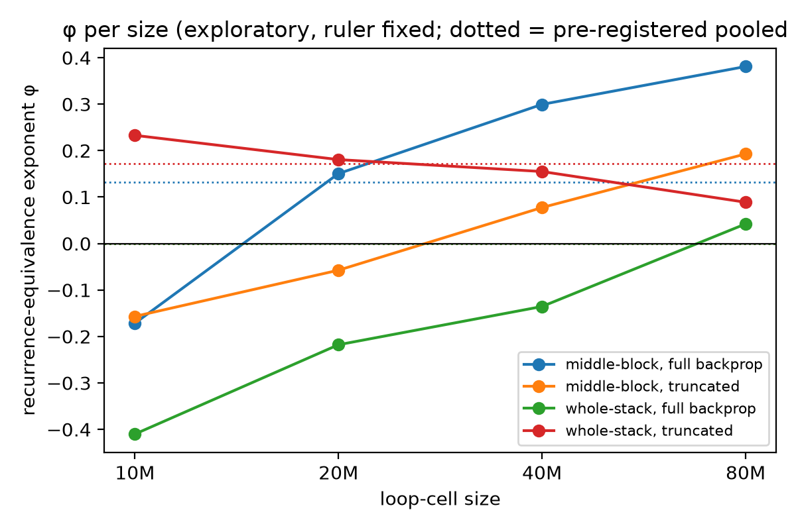
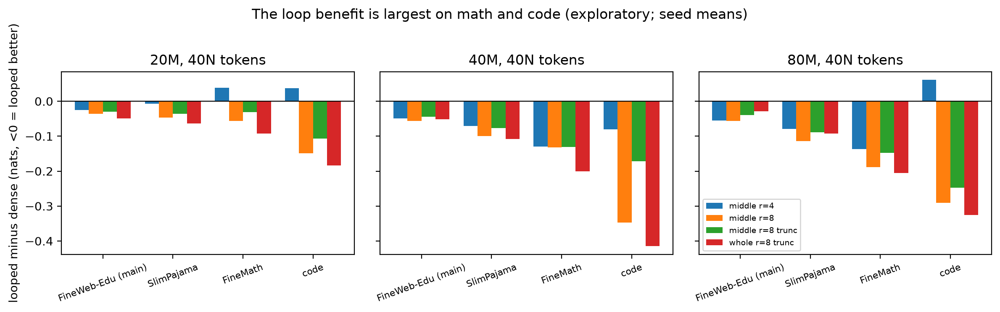
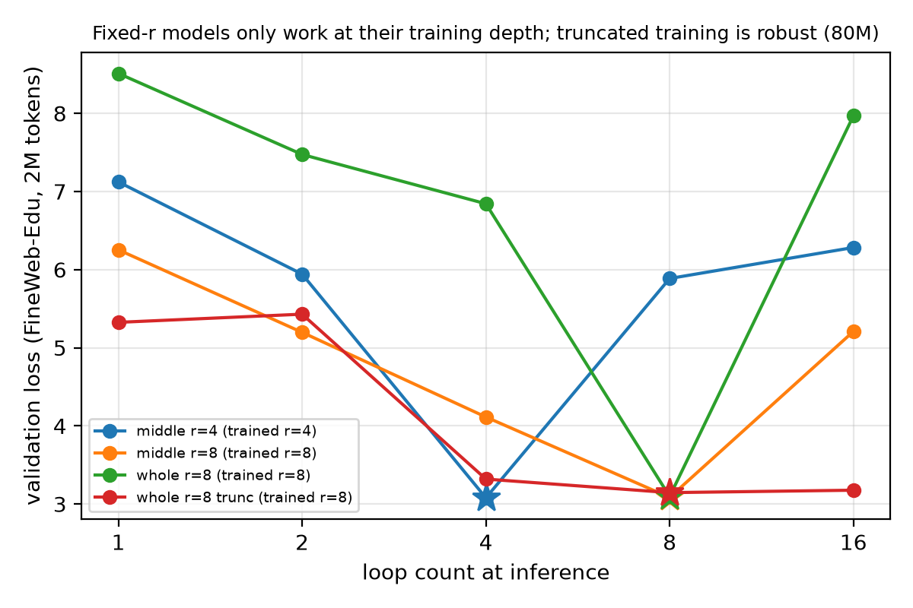
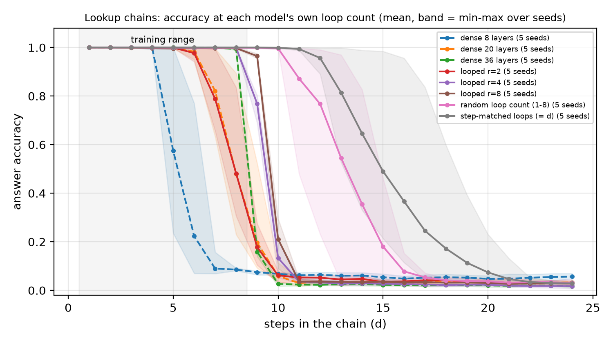

# What a loop buys: parameter efficiency on text, extendable depth on a serial task

**A pre-registered study of looped (recurrent-depth) transformers from 10M to 160M parameters: 111 training runs on a
frozen grid, three extension studies, a synthetic reasoning task, and nine supplementary experiments whose plans were
frozen before they ran.**

Qirun Li · October 2026 · technical report, results as of 2026-10-17 · code, configs, training logs and every number:
[github.com/bethehand/looped-scaling](https://github.com/bethehand/looped-scaling) · [中文版](report.zh.md)

---

## Summary

A looped (recurrent-depth) transformer runs one block of layers *r* times. It costs *r* times the compute of that
block and adds no parameters. Two things are expected of it: that it behaves like a larger model (parameter
efficiency), and that running more loops at inference lets it solve harder problems without writing a chain of thought
(latent reasoning). We measured both under one recipe: a pre-registered grid of 111 training runs (looped models of
10M–80M parameters, a dense reference up to 160M, three seeds at the small sizes), three extension studies, a synthetic
task that needs serial steps, and nine supplementary experiments in two batches (S1–S3, S4–S9) whose plans were frozen
before they ran.

<p align="center"><br><em>A. At equal parameters and tokens the looped model is worse than the dense model at 10M, mixed at 20M, and better at every budget from 40M on. B. The advantage grows with training tokens per parameter. C. On chains of table lookups (trained on 1–8 steps), only a loop run longer at inference solves longer chains; dense models and a written chain of thought stop at the training range.</em></p>

### On web text: parameter and data efficiency, not compute efficiency

1. **Looping wins at equal parameters from about 40M on, and loses at equal training compute.** At equal parameters
   and training tokens, a middle block looped 4 times goes from 0.02–0.10 nats of validation loss *worse* than the dense model at 10M to 0.03–0.06
   nats *better* at 160M (at 10–40 tokens per parameter), and the advantage keeps growing with the number of training
   tokens per parameter: at 160 tokens per parameter a 10M model looped 8 times matches a dense model trained on 1.7× as many
   tokens. At equal training compute and the shared learning rate the dense model wins all 258 comparisons in which
   its loss was measured, up to 640 tokens per parameter at 10M and 320 at 20M (S4); the margin shrinks with data per parameter, to 0.01–0.05 nats
   at the largest looped budgets, and with the looped model's own learning rate the two are at parity at 10M and 160
   tokens per parameter (−0.011 and +0.005 in two seeds), the only equal-compute comparison that is not a dense win.
   The other 62 comparisons need an extrapolated dense loss: 43 at 40M–160M and 19 at 10M–20M, almost all for the
   third seed, whose dense curve ends at 80 tokens per parameter. Re-tuning the learning
   rates of both models at 10M–40M (S1) leaves all three results intact; the shared rate had, if anything, understated
   the looped model, by about 0.02 nats at 10M.
2. **The pre-registered number, φ, is not identified in absolute terms**, because the dense ruler that converts loss
   into "effective parameters" is weakly identified: the primary fit gives φ = 0–0.17 per cell, a joint fit 0–0.41.
   Its trend is robust: per-size fits rise from below zero at 10M to about 0.65 at 160M. Measured without a ruler, a
   parameter of the middle block looped 4 times is worth 0.6–1.0 dense parameters at 10–20M with 10–20 tokens per
   parameter and 1.26–1.46 at 40M–160M with 20–40 (local φ 0.32–0.50 when N excludes the output head, as in
   Schwethelm et al., close to their 0.46; 0.35–0.52 with the head);
   published equal-parameter results at 130M–1.4B restate to a similar 1.2–1.6, and to up to about 2 for small
   blocks trained on 750–1500 tokens per parameter. φ is not a constant of the architecture.
3. **None of the four pre-registered hypotheses held as stated.** Truncated backpropagation did not lower φ (it helped
   whole-stack loops), a looped middle block beat a looped whole stack on raw losses but not consistently on φ, a form
   in which φ saturates in *r* did not extrapolate better than r^φ (the data cannot tell the two apart), and the dense
   model was compute-optimal under both training and deployment compute.
4. **On text, the loop does not iterate towards an answer.** Trained with a fixed loop count it runs a fixed-length
   program whose last loop is a large "write-out" step; with truncated backprop it learns a periodic cycle; with a
   random loop count (as in Huginn) it contracts to a fixed point. None gains anything from extra loops at inference,
   at any learning rate.

### On a task that needs serial steps: depth that can be extended at inference

5. **Step by step inside the loop, longer chains with more loops, and a stop that needs no answer.** On chains of table
   lookups, looped models advance the chain step by step (one step per loop when trained with 8 loops; probes show it)
   and, given more loops at inference, solve longer chains than they were trained on: a model trained with 8 loops goes from
   0.04 to 0.83 on 12-step chains with 16 loops (0.86 with the best larger loop count, chosen with the answers), and
   the gain fades with length (about 16 steps). Dense models fail right after the
   training range, even at the same executed depth with up to 4.4× the parameters; so do the fixed-loop models at
   their training loop count. The model's own
   confidence is a stopping rule that needs no answer: at a threshold of 0.99 it recovers 97–98% of the extra-loop gain
   for models trained with a fixed or a random loop count (S8). The model trained with as many loops as steps extends
   furthest (12.8 steps) but cannot stop by its state; trained to keep looping after the last step, it keeps its values
   and stops by confidence at 0.93 on 12-step problems, at the cost of about one step of extrapolation (S9). The
   learning rate decides whether any of this is learned: at the rate that is optimal for a dense model, 10 of 12 looped
   runs did not learn the task in the same number of steps (S2).
6. **Reasoning written out did not do this here.** Dense models that write the chain out as tokens solve the training
   range perfectly (1.000 in every seed and at every learning rate tried) at a third of the looped model's inference
   compute at its training loop count, and are at chance level on every longer chain, with 36 layers as well; the chain breaks at its first or
   second token as soon as the prompt holds more than 8 tables, a failure to generalize over the input length. Pause
   tokens add nothing (S5). Within the training range, tokens are the cheaper way to get the serial steps; beyond it,
   only the loop extended here.

### What it costs

7. **At deployment, loops cost latency and memory.** With one KV cache per executed layer, decoding time and cache
   grow with the executed layers. At equal loss (both models trained on 40 tokens per parameter), a middle block
   looped 4 times needs 14–19% less weight memory at 40M–160M, but 2.2–2.3× the KV cache and 2.4–2.5× the decoding
   time per token, and its peak memory at batch 32 is about 1.6× that of the dense model (S3). Sharing the KV cache
   across loops, which would remove most of that cost, is free only for the random-loop models, whose loops gain
   nothing; the fixed-loop models lose 0.09–0.17 nats, two to four times their gain over the dense model (S6).

### The one question underneath

When does running a block of layers again work as test-time compute? In this study, when the task needs the serial
steps and the loop is trained to iterate. On ordinary text the task rarely needs them, and what remains is a
parameter-efficiency gain that grows with scale and data, paid for in decoding time. Our reading of the two settings,
an interpretation that two settings cannot test, is that three conditions separate them: headroom (errors come from
too few serial steps, not from missing knowledge), extendable iteration (the loop can run longer without destroying
its state), and a stopping signal. The chain task has all three once the model is trained for them; web text, at
these sizes, shows none. Against a written chain of thought, on this one task, the loop was the only one of the two
that extended beyond the training range.

### How to read this report

- **Labels.** *Pre-registered*: the hypothesis and its decision rule were frozen on 2026-09-23, before any training run
  ([pre-registration](preregistration.md)). *Pre-specified*: written in a plan that was frozen before the runs it
  describes (the [synthetic design](synthetic-reasoning-design.md) and the two supplementary plans,
  [S1–S3](supplementary-experiments.md) and [S4–S9](supplementary-experiments-2.md)). *Exploratory*: chosen after
  seeing data. Every departure from a frozen document is dated in the [deviation log](deviation-log.md); the full
  numbers are in [results](results.md), cited below as "results §x".
- **Units.** Losses are in nats per token on held-out FineWeb-Edu unless another validation set is named. A difference
  of 0.01 nats is small but resolvable at these sizes: the spread between three initialization seeds is 0.015–0.024
  nats at 20M. "Tokens per parameter" is training tokens divided by N; "40N" means 40 tokens per parameter. N counts
  the non-embedding parameters plus the output head.
- **Words.** A *cell* is one looped configuration: which layers loop, how many times (*r*), and whether
  backpropagation runs through all loops or is truncated. A *rung* is one model size. The *middle block* loops the
  middle 4 of 8 layers and keeps the first two and last two unshared; the *whole stack* loops all 8. *Dense* means not
  looped. *Equal parameters* compares a looped model with the dense model of its own size trained on the same tokens;
  *equal compute* compares it with a dense model trained with the same training FLOPs, i.e. on more tokens.

---

## 1. Why this study

Looped transformers re-use a block of layers several times: Universal Transformers [1], and recently Huginn [2], Ouro
[3] and others. Two promises are made for them. First, **parameter efficiency**: a looped model should behave like a larger
dense model, which matters when memory or bandwidth, not arithmetic, limits deployment. Second, **latent reasoning**:
if the loop iterates on a problem, running more loops at test time should solve harder problems without writing out
a chain of thought.

Both claims are hard to check from the literature. Studies differ in data, tokenizers, training recipes and model
families; seeds are rarely reported; and the quantity of interest, how much one more loop is worth, is usually read
off a single fit. We therefore ran a controlled ladder of sizes with one recipe, wrote the hypotheses and the analysis
down before training ([pre-registration](preregistration.md), frozen 2026-09-23), and logged every later change
([deviation log](deviation-log.md)). When the text results left the second promise untested, we built a task that
needs serial steps, froze its design and predictions, and ran it the same way.

### Related work

**How much a loop is worth.** Kaplan et al. [4, App. D.2, Fig. 17] found that recurrent transformers, which re-use parameters,
"perform slightly better when comparing models with equal parameter count, but slightly worse when accounting for
reuse and comparing per FLOP"; our results agree in both directions. The effective-parameter form we test,
N_eff = N_once + r^φ·N_rec, and the layout with two unshared layers before and after the loop come from Schwethelm et
al. [5], who estimate φ = 0.46 (95% interval 0.41–0.53) on FineWeb-Edu with up to 8 loops, one seed per run and
non-embedding parameters only; our pre-registration was built to be comparable with theirs (our N also counts the
output head). Parcae [6] finds that looping lowers perplexity at matched parameters and tokens (not matched compute);
Lee et al. [7] that dense looped models scale worse than non-looped ones at equal FLOPs; Chen et al. [8] that tying the
weights of a deeper model costs a roughly constant factor of compute in single-epoch training, while with repeated data
the best loop count grows with compute. In a controlled appendix of Ouro [3], a dense model of the same depth beats the
looped one in every comparison, and plain recursion is worse than a vanilla model in validation loss at matched compute in [11].
For dense looped models and looped mixtures of experts alike, a bounded form extrapolates better than r^φ to 16 loops
[9]; with up to 8 loops our data could not separate a saturating form from r^φ (H3). A 1.4B looped model trained on 310B tokens (210B of pretraining, about 13 passes over a 16B-token
corpus, then 100B of mid-training) beats a dense model with the same parameters and data on all 12 of its benchmarks, at about 4× the training
compute per token, while a 3.9B dense model that matches its inference compute at three loops is ahead or level on every benchmark [10]. None of these
studies varies model size and tokens per parameter separately with several seeds; that is the main thing this study
adds (section 3.3).

**What the loop computes.** Huginn [2], trained with a random loop count, has latent trajectories that, in qualitative
examples, settle into fixed points or orbits or drift steadily in one direction. Logan [12] reports per-token convergence to a fixed point in a small depth-recurrent model, as
we find for random loop counts (section 4), and Huang et al. [13] find that fixed-depth training with full backprop
prevents sharing the KV cache across loops; in our 20M models sharing costs every model that gains from its loops
0.09–0.17 nats, with truncated backprop as well (S6). Saunshi et al. [14] find that the gains of looped models concentrate on
reasoning tasks, which may relate to our larger gains on math and code.

**Serial reasoning.** Recurrent networks solve harder problems than they were trained on by running more iterations,
and can "overthink" [15, 16]; looped transformers with an input-dependent number of loops generalise to longer inputs
[17]. Kohli et al. [18] show that recurrent-depth transformers extrapolate to deeper chains of composed facts with more
loops at test time (trained on up to 12 hops, they reach 14–19), while vanilla transformers of equal parameters or
equal FLOPs do not. Zhang et al. [19] find that the positions a loop resolves per iteration scale with the training
length divided by the training loop count, and that extra loops at test time rescue the later positions at a fixed input length. Our synthetic
results agree with both; we add several seeds, probes of every intermediate
value, the effect of the learning rate on whether the task is learned at all, stopping rules that need no answer, and
a comparison with a chain of thought [27] and pause tokens [28] at matched inference compute.

**Cost at inference.** Without sharing, a looped model's KV cache and decoding time grow with the number of loops: two
loops take about twice the KV memory and 1.96× the latency in [20], and plain looped decoding steps 2.3×, 3.4× and 5.7×
as long at 2, 3 and 5 loops in [21]. Schemes that share the cache across loops [3, 13, 21] (Ouro [3] during decoding only; [21] with a cache written by
the first loop) are tested here only as a post-hoc change to models trained without sharing (S6).

## 2. Setup

| | |
|---|---|
| Model sizes | looped models at 10M, 20M, 40M and 80M (widths 320 / 448 / 640 / 896, 8 unique layers); dense reference ("ruler") also at 160M (width 1280). N = non-embedding parameters + output head of the dense model [25]: 15.4M / 26.8M / 50.1M / 92.7M / 179.6M |
| Looped cells | **middle block** (2 layers once, 4 layers looped, 2 layers once) or **whole stack** (all 8 looped); r ∈ {2, 4, 8}; full backprop, or truncated backprop through the last r/2 loops at r = 4, 8 |
| Data | FineWeb-Edu [22] sample-10BT (10.4B tokens, one epoch, fixed order), 16k BPE. Validation: held-out FineWeb-Edu (main), SlimPajama, FineMath, code |
| Training | AdamW, WSD schedule with cooldown branches [26] at 10, 20 and 40 tokens per parameter (dense: 5–80, at 160M 5–40; extended to 160 at 10M and, in S4, to 640 at 10M and 320 at 20M); learning rates from a 33-run sweep (30 dense runs, 3 looped); 3 seeds at 10M–40M, 1 at 80M, 2 at 160M |
| Measurement | N_eff = N_once + r^φ · N_rec [5], with a ruler L(N, D) = E + A·N^−α + B·D^−β fitted on the dense models [23, 24]; Huber loss in log space, 500 random starts, 1000 block-bootstrap resamples. Ruler-free: loss gaps at equal parameters and tokens, dense sizes of equal loss by interpolation, equal-compute comparisons on the raw data |
| Synthetic task | chains of 1–8 table lookups in training (32 fixed random tables on 0–96), tested up to 24 steps; dense models of 8, 20 and 36 layers and 8-layer looped models (6.5–6.6M parameters; 16.1M and 29.0M for 20 and 36 layers), 5 seeds per condition, learning rates chosen by a sweep on in-range accuracy only; [design](synthetic-reasoning-design.md) frozen 2026-10-09 |
| Compute | 4× RTX 4090; the main grid took 11 days; the extensions about 5 more; the supplementary experiments S1–S3 1.3 more and S4–S9 1.5 more |

The four pre-registered hypotheses: **H1** truncated backprop lowers φ (under both iso-token and iso-FLOP
accounting); **H2** a looped middle block has a higher φ than a looped whole stack; **H3** φ saturates in *r*; **H4**
the compute-optimal *r* is small under training compute and larger under deployment compute.

## 3. What a loop is worth on text

### 3.1 The pre-registered verdicts

| Hypothesis | Verdict |
|---|---|
| H1 truncation lowers φ | Not supported. Middle block 0.00 vs 0.13 (predicted direction, overlapping intervals); whole stack 0.17 vs 0.00 (opposite direction). Same under iso-FLOP accounting. |
| H2 middle block > whole stack | Depends on the view. φ is mixed; raw losses at matched executed depth favour the middle block in 24 of 24 comparisons. |
| H3 saturation in r | Not supported. In the pre-registered extrapolation test the saturating form predicts 80M from 10M–40M better than r^φ (0.0085 vs 0.0096) but 10M from 20M–80M slightly worse (0.0203 vs 0.0200); the data do not separate the two forms. |
| H4 compute-optimal r | The dense model (r = 1) is optimal under both training and deployment compute. |

A surprise along the way: **truncated backprop helped whole-stack loops**. At 20M, a whole stack looped 4 times
reached 3.646 with truncation and 3.783 with full backprop at 10 tokens per parameter (three-seed means), and at 10M the only looped
cells better than the dense model on average over the three budgets were whole-stack loops with r = 8. Truncation also brought loss spikes: 30 of 111 runs had at least one, almost all in
truncated or whole-stack cells, and one run collapsed. Halving the learning rate removed the spikes in a follow-up.

### 3.2 Why the number φ is not settled, and what to measure instead

φ needs a ruler: the dense-model fit that says how much loss a given number of parameters buys. Fitted on our five
dense sizes, the ruler puts its irreducible loss at the lower bound and its parameter exponent at α = 0.054, far
below the usual 0.3. Five sizes cannot pin down E, A and α separately. A joint fit over all runs gives α = 0.267 and
larger φ (0–0.41 instead of 0–0.17). The pre-registered φ values are reported as such
([results §3](results.md)), but the conclusions below rest on quantities that need no ruler. For comparison,
Schwethelm et al. [5] report φ = 0.46 with their own ruler; with rulers this weakly identified, absolute values of φ
are hard to compare across studies.

<p align="center"></p>

**Without a ruler.** The dense runs themselves can serve as the ruler: for each looped model, interpolating between
the measured dense models trained on the same tokens gives the dense size N* with the same loss ([results
§5.17](results.md); exploratory). For the middle block looped 4 times, the multiplier N*/N rises from 0.6–1.0 at
10–20M with 10–20 tokens per parameter to 1.15–1.5 at 40M–160M. Per doubling of size it grows by ×1.21, and per
doubling of tokens per parameter by ×1.14 (×1.16 with 8 loops; these values include the dense models continued in S4,
[results §5.18](results.md)). It reaches 1, the point where a looped model is as good as a dense model of its own size,
at about 35M parameters with 20 tokens per parameter and about 12M with 80. At 40M–160M
with 20–40 tokens per parameter it stays at 1.26–1.46 (local φ with 4 loops 0.32–0.50 when N excludes the output head,
as in Schwethelm et al. [5], close to their φ = 0.46; 0.35–0.52 with the head), and
published equal-parameter results at 130M–1.4B [3, 6, 14] restate to a similar 1.2–1.6 (up to about 2 for the small
blocks of [14], trained on 750–1500 tokens per parameter). So φ is not a constant: the
pre-registered single value per cell averages a regime of small models trained on few tokens per parameter, where a
loop is worth less than its parameters, with one in which each parameter is worth about 1.4. That the value depends on
tokens per parameter is a loop × data effect; the published effective-parameter laws, in which it depends on the loop
count (and, for mixtures of experts, the sparsity) but not on the training tokens [5, 9], do not have it.

### 3.3 The value grows with scale and with data

<p align="center"></p>

**Scale.** The same cell, a middle block looped 4 times, compared with the dense model of the same size and seed
(Figure 12). At 40 tokens per parameter the loss difference is +0.018, −0.025, −0.050, −0.055 and −0.063 nats from 10M
to 160M (negative = looped better), and the curve is monotone at every budget. The two 160M seeds agree within 0.001
nats. Expressed as φ with the ruler held fixed (exploratory), the same cell gives −0.32, 0.19, 0.39, 0.52, 0.65. The
increments shrink in loss terms (0.043, 0.025, 0.005, 0.008 per doubling), and φ cannot exceed 1, so the curve must
bend somewhere; we do not see where yet.

<p align="center"></p>

**Data.** Continuing the finished 10M middle blocks looped 4 and 8 times to 80 and 160 tokens per parameter and the
20M ones to 80 (Figure 11), each doubling of the
data adds 0.02–0.03 nats of advantage for the middle-block cells, with no sign of saturation. Expressed as the amount
of data a dense model needs to match the looped one, a 10M middle block looped 8 times goes from 0.86× at 10 tokens per
parameter to 1.68× at 160 (seed 42 at 10, two seeds at 160); a 20M one reaches 1.65× at 80. Whole-stack loops show the same direction.

### 3.4 Equal compute: the dense model wins, by less and less

A looped run costs more compute than the dense run of the same size on the same tokens. Converting each looped run's
training compute into the number of tokens a dense model could have seen for it, and reading the dense loss off the
measured dense curve, the dense model is better in every comparison that can be measured. Before S4, 221 of the 320
comparisons were measured, all dense wins by at least 0.016 nats, and 99 needed the dense loss beyond its measured
curve. Two extrapolations bracket the truth: the slope of the last measured segment flatters the dense model (tested
on the measured curves, one doubling of extrapolation underestimates the loss by 0.02–0.08 nats at 40–160 tokens per
parameter), while a power law fitted to each curve flatters looping (it overstates the dense loss by 0.006–0.027 nats
per doubling). With the power law, looping came out ahead in 6 of the 99, by at most 0.021 nats, all at the largest
data per parameter ([results §5.17](results.md)). Supplementary experiment S4 then continued the 10M dense models to
640 tokens per parameter and the 20M ones to 320, so that 258 of the 320 comparisons are measured: the dense model wins
all of them (at the shared learning rate), and the measured gaps fall about halfway between the two extrapolations. The
other 62 comparisons still need an extrapolated dense loss: 43 at 40M–160M and 19 at 10M–20M, almost all for the third
seed, whose dense curve ends at 80 tokens per parameter.

| Looped cell (size, tokens per parameter) | Training compute, relative to the dense model of the same size | Gap at equal parameters and tokens | Gap at equal compute |
|---|---|---|---|
| Middle block r = 4 (10M, 160N) | 2.2× | −0.033 | +0.016 |
| Middle block r = 8 (10M, 160N) | 3.7× | −0.051 | +0.034 |
| Middle block r = 4 (20M, 80N) | 2.2× | −0.051 | +0.022 |
| Middle block r = 8 (20M, 80N) | 3.8× | −0.064 | +0.052 |

Looped minus dense loss on the main validation set, means over seeds 42 and 43; negative = looped better. At equal
compute the dense model is trained on 2.2–3.8× the tokens ([results §5.18](results.md), S4).

The margin shrinks with data per parameter: for the middle block looped 4 times at 10M it is +0.119 at 40N, +0.062 at
80N and +0.016 at 160N, and at 20M +0.138, +0.075 and +0.022 from 20N to 80N. With the looped model's own learning rate
(0.35× the dense rate, found in S1), the 10M middle r = 4 model reaches parity at 160 tokens per parameter (−0.011 and
+0.005 in two seeds), the first equal-compute comparison in this study that is not a dense win; whether it would become
a win with still more data per parameter is not measured. Within the measured range, loops are a way to trade compute
for parameters and data, not a way to save compute.

### 3.5 Learning rates

All looped language models used the dense models' learning rates, after a check at 20M and 10 tokens per parameter,
with its decision rule written before its runs, found no better one. Supplementary experiment S1 re-tuned both the dense model and the
middle block looped 4 times at 10M, 20M and 40M (0.5–1.41× the dense rate, plus 0.35× where the pre-set edge rule
required it) at 10–40 tokens per parameter (at 10M also 80 and 160), with one seed (two at 20M), so its gaps differ slightly from the
three-seed means of section 3.3. The dense model's best rate stayed at 1× (at 40M, 0.71× was better by 0.001 nats at 40 tokens per
parameter and by 0.004 at 80). At 20M–40M the shared rate understated the looped model's advantage by at most 0.005
nats, but at 10M the looped model preferred 0.5× and below from 20 tokens per parameter on, worth about 0.02 nats. With each side at its best rate,
the gap at 40 tokens per parameter is −0.005, −0.031 and −0.055 nats from 10M to 40M (shared rate, same seeds: +0.015, −0.031,
−0.050): the scale trend is somewhat smaller but holds by the rule fixed in advance; the data trend at 10M is larger
(+0.082 at 10 tokens per parameter to −0.059 at 160). At equal compute the dense model won all 11 comparisons of the
re-tuned runs, but the one at 10M and 160 tokens per parameter used an extrapolated dense loss; measured in S4, it is the
parity of section 3.4 ([results §5.16 and §5.18](results.md)).

### 3.6 Where the gain lands, and what the seeds measure

<p align="center"></p>

Per token, the gain on web text is a small, broad shift: about half of the tokens improve, and the gain is not
concentrated on hard tokens beyond what two dense seeds differ by. On math and code the gain is larger (on average about
3 and 7 times; 1.5–7 and 4–11 times across cells), but the seed-to-seed noise on those sets is 10–100 times larger too
(Figure 5). Supplementary experiment S7 traced that noise to the data order. At 20M, training the same initialization
on three disjoint parts of the data stream moves the main-set loss by 0.003–0.011 nats, 0.1–0.5× the spread between
initialization seeds, so the seed intervals in this report need no caveat. On the code set the data order moves the
loss by 0.21–0.69 nats, up to 7× the initialization spread, and the paired looped-minus-dense gap changes sign between
orders. Which documents a run happens to see decides its out-of-distribution loss at this size, so the
out-of-distribution sets carry no fine comparison here ([results §5.18](results.md), S7).

## 4. What the looped block computes on text

We probed trained models loop by loop: reading the state after each loop with the model's own output layers (a "logit
lens"), with a trained linear map in front of them, and with a trained linear head.

<p align="center"></p>

- **Fixed loop count (r = 8).** With a trained linear map, the state after loop 4 already reads out within 0.1–0.2
  nats of the final loss, and loops 5–7 add little. The last loop is a large non-linear move that rewrites the state
  into what the output layers expect; 37–44% of the tokens settle their prediction only there. Running fewer or more
  loops at inference breaks the model (Figure 6). This replicated across seeds at 20M and 40M.
- **Truncated backprop (whole stack, k = 4)** learns a period-4 cycle: the state returns to almost the same point every
  4 loops, so the model works at 4, 8, 12 or 16 loops and gains nothing from more.
- **Random loop count during training** (r drawn from 1–8 at every step, as in Huginn) learns a contraction to a fixed
  point: the loss at 1 to 32 inference loops is flat after about 4 loops (Figure 10). The model is robust to the loop
  count, but at its nominal 8 loops it is 0.05 nats worse than fixed-r training and ties the dense model.
- **Learning rate.** Lower learning rates give flatter curves over the inference loop count. This showed first in
  the 20M models of the looped learning-rate check, and S1 confirmed it at 10M, 20M and 40M (middle block
  looped 4 times, checkpoints at 32 tokens per parameter): over 4–16 loops the loss varies by 0.36–0.77 nats at 0.5×
  the dense rate and by 3.4–4.6 nats at 1.41×. Lower rates make the iteration closer to convergent, but on text more
  loops than trained never helped, at any rate.

<p align="center"></p>

<p align="center"></p>

## 5. Can loops learn to reason step by step?

### 5.1 The task and the conditions

Text gives the loop little reason to iterate: predicting the next word rarely needs many serial steps. We therefore
built a task that does ([design](synthetic-reasoning-design.md), frozen 2026-10-09). A problem lists a start value
and a sequence of table lookups, for example `25 ; LUT 7 ; LUT 3 ; LUT 19 ; … =>`, where each LUT is one of 32 fixed
random functions on 0–96; the model must output the final value in a single forward pass. Two lookups compose into one
of 1024 arbitrary functions, so a model that skips steps must memorise rapidly growing tables of compositions; the task
rewards computing step by step, although, as for any associative composition, a shallower solution exists in
principle. Models are trained on
1–8 steps and tested up to 24. Problems are drawn at random during training, so short ones repeat (there are only
3,104 one-step problems), but chains longer than 8 steps never occur in training. We compare dense models of 8, 20 and 36 layers with an 8-layer looped model (2 + 4×r +
2 executed layers) trained with r = 2, 4 or 8 loops, with a random loop count, or with as many loops as the chain has
steps. Every condition uses the learning rate picked by a sweep on in-distribution accuracy only, and has 5 seeds.
Two further conditions, dense models that write the intermediate values out as a chain of thought and a dense model
with pause tokens, were added in S5 (section 5.6), and one more looped regime, loops = steps plus random extra loops,
in S9 (section 5.5).

### 5.2 Results at the training loop count and with more loops

| Model | Params | Largest solvable step count* | With more loops at inference | Accuracy at 12 steps: own loops / more loops** | at 16 steps** |
|---|---|---|---|---|---|
| Dense, 8 layers | 6.5M | 4.2 (4–5) | — | 0.06 | 0.05 |
| Dense, 20 layers | 16.1M | 6.4 (6–7) | — | 0.04 | 0.03 |
| Dense, 36 layers | 29.0M | 8.0 (8–8) | — | 0.02 | 0.02 |
| Looped, r = 2 | 6.6M | 6.4 (6–7) | 8.6 (6–11) | 0.05 / 0.64 | 0.04 / 0.33 |
| Looped, r = 4 | 6.6M | 8.0 (8–8) | 11.8 (10–15) | 0.03 / 0.83 | 0.03 / 0.28 |
| Looped, r = 8 | 6.6M | 9.0 (9–9) | 11.2 (11–12) | 0.04 / 0.86 | 0.03 / 0.37 |
| Looped, random loop count | 6.6M | 11.4 (10–13) | 12.2 (10–15) | 0.77 / 0.83 | 0.08 / 0.49 |
| Looped, loops = steps | 6.6M | 12.8 (11–16) | — | 0.96 | 0.37 |

\* mean (min–max) over 5 seeds of the longest chain length up to which every length is solved at ≥ 90%, at the
model's own loop count. \*\* at the model's own loop count / the best of the own and every larger inference loop count, including d
loops (for r = 2 these include 4 and 8 loops, which the first version left out), chosen per seed with the answers, mean
over seeds. Chance is 0.01.

<p align="center"></p>

### 5.3 Loops buy steps; what the dense models lack is the option to run longer

At equal parameters, more loops solve longer chains (4.2 → 6.4 → 8.0 → 9.0 steps). The dense models of equal executed
depth, with 2.4–4.4× the parameters, solve 1–1.6 fewer steps (the 20-layer one did not fully learn the training
range) and fail right after the training range: at 12 steps they score 0.02–0.06. So do the fixed-loop models at their
training loop count (0.03–0.05). With more loops those reach 0.64–0.86, the random-loop model 0.83 and the
loops = steps model 0.96.

<p align="center"></p>

**More loops at inference solve longer chains** (Figure 14). A model trained with 8 loops solves 9 steps at 8 loops
and about 11 with 16 or 32. The gain is real but bounded: at 16 steps it is at 0.37. The model trained with a random
loop count gains as well: at 16 steps its accuracy rises from 0.08 with 8 loops to 0.49 with 16. The model trained
with loops = steps, run with as many loops as the chain has steps, beats 8 loops by 0.34–0.95 (seed means) at every
length from 10 to 16 steps, which is what the pre-specified prediction P3(c) asked for.

### 5.4 One step per loop

<p align="center"></p>

We train a linear probe for each intermediate value x_j at its own position in the input, after every loop (Figure
15). In the model trained with 8 loops, x_j appears at about loop j (x_8 at loop 8; 1.0–1.1 loops per step in all 5
seeds), and each value stays decodable afterwards (persistence 0.96). The model trained with loops = steps also
computes one step per loop and keeps its values while it runs its d loops (0.92), but loses them when run longer,
which is why it needs about d loops: it was never trained to keep looping after the last step, while the fixed-loop
model was. Models trained with fewer loops pack more steps into each loop (about 1.6 per loop at r = 4, 2.4 at r = 2),
just enough to cover the training range. The dense models compute late, from about layer 21 of 36, and in 5 of the 10
seeds of the 20- and 36-layer models no intermediate value appears at the step positions at all (four show only the
answer, at the last layer, and one nothing).

### 5.5 Knowing when to stop

Extra loops help only if the model can tell how many to run. Three ways to stop without the answer were tried on the
same checkpoints.

- **The state rule of the frozen design**: stop when the state at the answer position changes by less than 2% from one
  loop to the next, at most 32 loops. It had been computed in every run but was not reported until 2026-10-15
  ([results §5.15](results.md)). For the models trained with 4 or 8 loops it recovers about 80% of the gain of the best
  fixed loop count at 12 steps and 60–70% at 16, running 11–19 loops, without hurting the training range. The model
  trained with loops = steps, which extends furthest, cannot stop by it: its state keeps changing after d loops, and
  the stop lands on a wrong loop at every length (accuracy 0.03–0.08). It extends furthest only because the problem
  states the number of steps.
- **Other answer-free rules (S8)**, compared on the same 25 checkpoints with the rules and thresholds fixed in the plan,
  selected on one problem set and reported on another: the model's own confidence (stop when the top probability
  reaches 0.99) does best. It recovers 97–98% of the best fixed count's gain at 12 steps for the models trained with 4
  or 8 loops or a random count, using fewer loops than their training count in range, and brings the loops = steps
  model to 0.76 at a cost of 6–7% of the in-range problems. Stopping when the prediction stops changing fires on
  stable wrong answers (the fixed-loop models' read-out turns only in the last loop); majority votes over loop counts
  tie the best fixed count but never beat it and are not stopping rules.
- **A regime that gives both (S9)**: the loops = steps model trained with 0–4 random extra loops after the last step
  keeps its values (persistence 0.04 → 0.91), extends about one step less (11.6 against 12.8 at the 90% line), and
  stops by confidence at 0.93 on 12-step problems while keeping 0.998 in range, using fewer loops than d. By the state
  rule its stop is seed-dependent (0.52; two seeds work, two fail), which is why the plan's own reading would have
  called it "persistence without a usable stop". Training it costs about 1.4× the compute per step.

| Model | Own loop count | Best fixed count (chosen with the answers) | State change < 2% | Confidence ≥ 0.99 (mean loops used) |
|---|---|---|---|---|
| Looped r = 2 | 0.05 | 0.62 | 0.45 | 0.70 (8.3) |
| Looped r = 4 | 0.04 | 0.83 | 0.65 | 0.81 (9.2) |
| Looped r = 8 | 0.04 | 0.86 | 0.71 | 0.84 (17) |
| Random loop count | 0.77 | 0.83 | 0.73 | 0.83 (14) |
| Loops = steps (own = d loops) | 0.96 | 0.96 | 0.03 | 0.76 (14), and 6–7% lost in range |
| Loops = steps + 0–4 extra loops (S9) | 0.90 | 0.94 | 0.52 | 0.93 (14), 0.998 kept in range |

Accuracy on 12-step chains, seed means on the S8 reporting set ([results §5.18](results.md), S8 and S9). Extending
far and stopping came from different training regimes; a regime that gives both exists, at a small cost in
extrapolation.

### 5.6 Loops against reasoning written out

The chain task was also given to dense models that write the intermediate values out as tokens (8 layers, the looped
models' size; 36 layers, their executed depth) and to an 8-layer model with d pause tokens [28], five seeds each, with
learning rates chosen as for the other conditions (supplementary experiment S5, [results §5.18](results.md)).

| Model | Params | In range (1–8 steps) | 12 steps | 16 steps | Layer passes per 12-step problem |
|---|---|---|---|---|---|
| Dense 8 layers, chain of thought | 6.5M | 1.000 | 0.014 | 0.015 | 416 |
| Dense 36 layers, chain of thought | 29.0M | 1.000 | 0.017 | 0.013 | 1872 |
| Dense 8 layers, d pause tokens | 6.5M | 0.566 (solves 4 steps) | 0.015 | 0.012 | 416 |
| Dense 8 layers, single answer | 6.5M | 0.62 (solves 4.2 steps) | 0.064 | 0.048 | 320 |
| Looped r = 8, 8 loops / 16 loops | 6.6M | 0.998 | 0.036 / 0.827 | 0.033 / 0.285 | 1440 / 2720 |
| Looped, loops = steps, run with loops = d | 6.6M | 1.000 | 0.957 | 0.366 | 2080 |

Seed means; the inference cost counts layer passes over the tokens processed (a 12-step prompt has 40 tokens; the
chain-of-thought models generate 12 more with a KV cache).

Within the training range the chain of thought is perfect (1.000 in every seed at every rate tried), where the
single-answer 8-layer model solves 4 steps, and at 12 steps it costs a third of the looped model's inference compute at its training loop count (416 layer
passes against 1440; the 16 loops that solve 12-step chains cost 2720).
Beyond the range it does not extend at all: 0.014 at 12 steps for 8 layers and 0.017 for 36, chance level, against
0.83–0.96 for the looped models on the same longer prompts. A diagnostic shows the chain breaking at its first or
second token as soon as the prompt holds more than 8 tables, under teacher forcing as well: a failure to generalize
over the input length, the known weakness of transformers on inputs longer than those seen in training [31, 32], not
an accumulation of errors along the chain. The prompt of this task grows with the number of steps, so this comparison
cannot say whether a written chain would extend on a task whose input length does not; remedies for length
generalization were not part of the plan. Pause tokens add nothing (4 steps, as without them). So on this task the
question "loops or tokens?" has two answers: for problems like the training ones, tokens, cheaper and perfect; for
longer ones, loops, the only form of extra computation that extended here.

### 5.7 The learning rate decides whether the loop learns the task

All looped models above were trained at 1.25e-4–2.5e-4, 2–8 times lower than the learning rates chosen for the dense
models (5e-4–1e-3). In the learning-rate sweep (seed 1) the same r = 8 architecture trained at 1e-3 worked only at
exactly 8 loops and had no step-by-step frontier, like the language models of section 4; but it had also learned the
training range much worse (accuracy 0.54 against 0.999 at 2.5e-4, after the same 16000 steps). Probes on all sweep
checkpoints show the same split: for looped r = 8 the step-by-step frontier is present at learning rates up to 5e-4
(about one step per loop at 1.25e-4 and 2.5e-4, one per 1.5 loops at 5e-4) and absent at 1e-3 and 2e-3; looped r = 4
and the random-loop-count model behave the same way. Supplementary experiment S2 then trained the four extrapolating
looped conditions (r = 2 was left out because the first analysis missed its extrapolation) at 5e-4 and 1e-3 for the
full 32000 steps with three seeds. At 1e-3, 10 of 12 runs still did not learn the training range (accuracy 0.49–0.98).
At 5e-4, 8 of 12 did, and those mostly extended about as far as the formal runs (looped r = 8: 2.7 steps beyond the
training range against 3.2; loops = steps: 4.0 against 4.8); the exception was the random loop count, whose two learned
seeds extended 2 steps against 4.2. So a high learning rate mainly keeps the looped model from learning the task in
the given steps; when it does learn the task, it mostly learns the same extendable algorithm
([results §5.16](results.md)).

### 5.8 Against the pre-specified predictions

The frozen design made five predictions ([results §5.15](results.md)). P1 (more loops, more steps at equal
parameters) holds in direction, but r = 8 did not reach 16 steps. P2 (iso-depth dense models at least as good) does
not hold as stated, but the gaps are small (1–1.6 steps, within P2's tolerance at r = 8). P3 (inference-time scaling):
its first two parts fail in the direction that favours looping, since fixed-r models were *not* hurt by extra loops
and the random-loop-count model, predicted not to gain, gained on long chains, and its third part holds (the
loops = steps model extends to 16 steps; corrected 2026-10-15). P4 (only the step-matched model's probe table is
diagonal) is half right: the fixed-r model's is too. P5 (much larger gaps than on text) holds. Of the supplementary
predictions, S5 held one of three, S8 one of five, S9 three of four; the readings are in [results §5.18](results.md).

## 6. What loops cost at deployment

At equal parameters a middle block looped 2, 4 or 8 times costs 1.4–1.5×, 2.2–2.4× or 3.7–4.1× the training FLOPs per
token of the same-size dense model, and 1.5×, 2.4–2.6× or 4.5–4.6× its decoding time per token (one RTX 4090, bf16,
KV-cached decoding with one cache per executed layer, the computation the models were trained with; supplementary
experiment S3, [results §5.16](results.md)). The fairer comparison is at equal loss, against the dense model that
reaches the same loss at 40 tokens per parameter (interpolated between the dense sizes):

| Cell | Sizes | Weight memory | KV cache per token | Decoding time, batch 1 | Peak memory, batch 1 | Peak memory, batch 32 |
|---|---|---|---|---|---|---|
| Middle block r = 2 | 20M–80M | 0.93–1.03× | 1.43–1.51× | 1.45–1.49× | 0.99–1.15× | 1.21–1.24× |
| Middle block r = 4 | 20M–160M | 0.81*–0.96× | 2.20–2.41× | 2.37–2.47× | 0.98*–1.20× | 1.57–1.58× |
| Middle block r = 8 | 20M–80M | 0.83–0.92× | 4.01–4.23× | 4.27–4.56× | 1.08–1.34× | 2.29–2.40× |
| Whole stack r = 4 | 20M–80M | 1.03–1.11× | 4.02–4.27× | 4.00–4.11× | 1.18–1.84× | 2.32–2.41× |
| Whole stack r = 8 | 20M–80M | 0.81–0.85× | 6.96–7.23× | 7.57–7.91× | 1.27–1.50× | 3.38–3.91× |

Ratios of the looped model to the dense model of equal loss; \* 160M lies beyond the largest dense model
(extrapolated).

At equal loss the looped models save at most 19% of the weight memory (middle block r = 4: 4%, 14%, 17% and 19% from
20M to 160M) and pay roughly their extra executed layers in decoding time and KV cache. At batch 1 the larger KV cache
cancels nearly all of the saving in weights (80M–160M: 1–2% less peak memory), and with more sequences the KV cache
makes looped models need more memory (1.2–3.9× at batch 32 with a 1k context). So in this range loops save
parameters, not latency or memory; the saving would grow where weights dominate memory, e.g. one sequence with a short
context in a much larger model, which we did not test.

**Sharing the KV cache across loops** would remove most of this cost: one cache slot per unique layer, written at a
position's last loop and read by every later loop. Supplementary experiment S6 applied it to trained 20M models
([results §5.18](results.md)):

| Model (20M, seed 42, 32N trunk) | Inference loops | Cache slots, full → shared | Loss, full cache | Loss, shared cache | Δ |
|---|---|---|---|---|---|
| Middle block r = 8, full backprop | 8 | 36 → 8 | 3.443 | 3.534 | +0.091 |
| Middle block r = 8, truncated backprop | 8 | 36 → 8 | 3.451 | 3.591 | +0.140 |
| Middle block r = 8, random loop count | 8 | 36 → 8 | 3.496 | 3.496 | 0.000 |
| Middle block r = 4, full backprop | 4 | 20 → 8 | 3.442 | 3.611 | +0.170 |
| Middle block r = 4, full backprop, half the learning rate | 4 | 20 → 8 | 3.425 | 3.525 | +0.100 |

Every model that gains from its loops at this size loses two to four times that gain when the cache is shared
(0.09–0.17 nats against gains of 0.03–0.05 over the dense model), so with a shared cache it would fall below the dense
model of the same size; truncated backprop does not make the cache shareable here, against the finding of Huang et al.
[13]. The only models that share for free are those trained with a random loop count, whose looped block contracts to
a fixed point (section 4) and which gain nothing over the dense model. Among the fixed-loop models, a lower learning
rate loses less (0.100 against 0.170), which points to training towards convergence, or with a shared cache, as the
way to get sharing; Monea et al. [21] pretrain looped models with a different scheme, in which only the first loop
writes a cache and later loops read it while keeping a short window of their own, and find that it costs no quality.
Neither was tested here.

## 7. Practical takeaways

- **Loop when parameters or data are the constraint, not compute or latency.** The advantage at equal parameters
  grows with model size and with tokens per parameter (section 3.3); at equal compute and a shared learning rate a
  dense model is better in every measured comparison, by a margin that shrinks with data, and with the looped model's
  own rate the two tie at 10M and 160 tokens per parameter (3.4); at deployment the loop pays its executed layers in
  decoding time and KV cache (6).
- **Loop a middle block, with full backprop.** Middle-block loops beat whole-stack loops at matched depth in every
  comparison. Truncated backprop accounted for 25 of the 30 runs with loss spikes (16 of them whole-stack loops);
  halving the learning rate removed the spikes in a 10M follow-up.
- **Start with r = 4 on text, and judge at your target scale.** At 40M–80M, r = 8 did about as well as r = 4 while
  costing about 1.75× the training compute and 1.8× the decoding time and KV cache. A loop is worth more at larger sizes and with more tokens per parameter, so small-scale
  ablations undersell it.
- **Do not expect test-time scaling on text.** Fixed-loop training gives a model that only works at its training loop
  count; random-loop training makes it robust to the loop count but not better with more loops (section 4).
- **Tune the looped model's learning rate separately**, especially at small scale and for step-by-step tasks. On text
  the dense rate was close to the looped model's best at 20M–40M but 0.02 nats off at 10M; on the reasoning task, at
  the dense-optimal rate most looped runs did not learn the task in the same number of steps (5.7). Sweep the loop
  count at inference to see whether the model can use more loops: on text none of ours could; on the chain task,
  models whose accuracy held at more loops also solved longer chains with them. A model that works only at its
  training loop count may still compute step by step within those loops (the loops = steps model does); probes tell
  the two apart (5.4).
- **Count the KV cache and the latency, not just the parameters.** At equal loss the looped models saved at most 19%
  of the weight memory and needed 1.2–3.9× the peak memory at batch 32; sharing the cache across loops costs the
  fixed-loop models two to four times their gain (6).
- **On a task that needs serial steps, choose between loops and a chain of thought by the lengths you need.** Within
  the training range a chain of thought was cheaper and perfect; beyond it only the loop extended (5.6). If the model
  must stop by itself, use its confidence: a 0.99 threshold recovered nearly all of the extra-loop gain, and training
  with loops = steps plus a few random extra loops gave a model that both extends and stops (5.5).

## 8. What went wrong, and what we changed

Every item below is dated in the [deviation log](deviation-log.md).

- **Two power failures** of the training machine (2026-09-24 and 2026-10-07) cut CPU speed by about 30×; runs resumed
  from checkpoints and no result was affected.
- **Hyper-parameters are those of the dense models.** A learning-rate check for looped cells, with its rule written
  before its runs (20M,
  0.5–1× the dense rate, 10N) found no better rate, but 9 of 10 cells were best at the upper edge of the tested range,
  and the check covered neither longer budgets nor other sizes. Supplementary experiment S1
  ([plan](supplementary-experiments.md), frozen before it ran) re-tuned both the dense and the looped model at
  10M–40M at every budget up to 40N (160N at 10M): the scale, data and compute results hold, and the shared rate had
  understated the looped model's advantage by up to 0.024 nats at 10M (at most 0.005 at 20M–40M). On the synthetic task the best
  looped learning rate was 2–8× lower than the dense one (the seed-1 sweep).
- **The synthetic task changed twice before its formal runs.** Modular-arithmetic chains were not learnable from a
  flat mixture of lengths (a curriculum was added) and remained very slow to learn, so the operations were replaced
  by fixed lookup tables. Both changes were made before any comparison between conditions.
- **The learning-rate criterion saturated.** Several looped conditions scored about 0.999 in-distribution at two or
  three learning rates; ties went to the lowest rate by implementation, which the protocol had not specified, and
  extrapolation turned out to be sensitive to this choice. It saturated again for the chain-of-thought conditions of
  S5 (1.000 at every rate).
- **A pointer-chasing control was dropped.** It was never piloted; under the chain-calibrated recipe no condition
  learned even a single hop.
- **The first probe read only one position** per step and missed intermediate values that one seed stores elsewhere;
  it now reads three positions and keeps the best.
- **An external review found five errors after these results were first published (corrected 2026-10-14).** (1) The
  verdict that the random-loop-count model does not gain from extra loops used the longest solvable chain instead of
  the accuracy difference the design specified; by the latter it gains (16 steps: 0.08 → 0.49). (2) The batch-1 peak
  memory in S3 counted two KV caches; it was re-measured. (3) The AIC used for H3 is a proxy from the Huber loss, not a
  likelihood-based AIC, and is no longer cited as evidence. (4) The extrapolation test of H3 kept the 160M rung in its
  training set, unlike the pre-registered split; redone, it no longer favours r^φ in both directions. (5) The design
  said synthetic problems never repeat; short ones do. A sixth finding, that relaunching a finished run could
  overwrite its configuration record, affected no published run (all 219 records match their results); the trainer
  now refuses such a relaunch.
- **A second review (2026-10-15) found further errors, corrected.** On the synthetic task: the pre-registered P3(c)
  holds by its own decision quantity (it had been marked partly met because one requirement, solving 16 steps in every
  seed, is not in the design); P4 was judged with a measure the design does not name (the diagonal share gives the
  same verdict); the claim that the loops = steps model overwrites its values was wrong (it keeps them for its d loops);
  the 12-step comparison with dense models mixed in extra loops; and the "best over loop counts" left out 4 and 8 loops
  for r = 2. On text: the equal-compute comparison now states that 99 of 320 comparisons rested on an extrapolation that
  favours the dense model (62 after S4); and about 20 numbers and phrases were corrected, among them the joint-fit φ
  (0–0.41), the claim that φ falls with r within every rung (only at 80M), and that the training logs were in the
  repository (they were added on 2026-10-15). Details in the deviation log.
- **An evaluation the design pre-specified was computed but not reported** until 2026-10-15: the adaptive stop of the
  step-matched condition. It is now in section 5.5 and [results §5.15](results.md), together with the same stop for the
  other conditions (exploratory).
- **Two synthetic conditions of S5/S9 ran out of memory** (2026-10-16): the two deepest ones had been tested only on
  the CPU before the plan was frozen and did not fit a 24 GB card at the design's batch size; they were rerun with
  gradient accumulation over two half-batches (the same loss and update), seven hours later than planned. The trainer
  now logs its peak GPU memory.
- **One unexplained anomaly:** at 160M, one looped seed is 0.2–0.6 nats worse than the other on the
  out-of-distribution sets at 40 tokens per parameter, while the main-set losses are identical.

## 9. Limitations

- Scale: 10M–160M parameters and a 16k vocabulary, far below the 1B+ models where looped LMs are deployed. The
  scaling trends may bend; we have five sizes, one seed at 80M and one looped cell at 160M.
- One data source (FineWeb-Edu), one epoch; multi-epoch regimes, where loops may matter more [8, 30], are not covered.
- Deployment cost was measured on one GPU type, for models of at most 160M parameters, with one KV cache per executed
  layer; larger models, where weights dominate memory, were not tested, and sharing the cache across loops was measured
  only as a post-hoc change to models trained without it (S6).
- The learning rate was re-tuned for one looped cell at 10M–40M (S1), with one seed (two at 20M); the other cells,
  80M and 160M use the dense rates.
- The synthetic evidence comes from one task family and 6.6M-parameter models; extrapolation length varies widely
  across seeds.
- The comparison with reasoning written out (S5: a chain of thought [27] and pause tokens [28]) covers one synthetic
  task, 6.5M–29M-parameter models and one training regime. In this task the prompt grows with the number of steps
  (3d + 4 tokens), so the chain-of-thought models' failure beyond the training range is a failure to generalise to
  longer inputs, which the looped models handle on the same prompts; whether a written chain extends on a task whose
  input length does not grow with the number of steps was not tested. The chain-of-thought models were given no help
  with length generalization, and continuous thoughts [29] were not tried.
- Seeds change only the initialisation, except in S7, which varied the data order at 20M: in distribution it matters
  less than the initialisation, out of distribution more.
- 62 of the 320 equal-compute comparisons rest on an extrapolated dense loss (section 3.4): 43 at 40M–160M and 19 at
  10M–20M, almost all for the third seed, whose dense curve ends at 80 tokens per parameter; the other 10M–20M dense
  curves now reach 640 and 320 tokens per parameter (S4).
- Four follow-ups were considered and not run (the author's decision, 2026-10-17): a second synthetic task family with
  a fixed input length, a dense control of equal executed depth on text, two more seeds at 80M, and dense and looped
  models trained on reasoning-heavy text. Each leaves one of the limitations above in place ([roadmap](roadmap.md),
  [paper plan](paper-plan.md)).

## 10. Reproducing

```
cd code
uv venv --python 3.11 && source .venv/bin/activate && uv pip install -e ".[test]"
python -m pytest tests -q
```

[code/README.md](../code/README.md) lists the full sequence: data preparation, learning-rate sweep, main grid, fits,
extensions, supplementary experiments and figures, and maps every table and figure to the command that makes it.
Every run's results are in `code/results/runs/` (the per-run training logs in `code/results/train_logs/`), the fits in
`code/results/fit/`, the synthetic results in `code/results/synthetic/`, the supplementary results in
`code/results/supp/` and `code/results/supp2/`, and all figures are produced by `code/fit/make_figures.py`,
`code/fit/make_overview.py` and `code/synthetic/analyze.py`.

## References

Venues are given only where the arXiv page states one; arXiv versions as of 2026-10-15.

[1] M. Dehghani, S. Gouws, O. Vinyals, J. Uszkoreit, Ł. Kaiser. *Universal Transformers*. ICLR 2019. [arXiv:1807.03819](https://arxiv.org/abs/1807.03819)

[2] J. Geiping, S. McLeish, N. Jain, et al.. *Scaling up Test-Time Compute with Latent Reasoning: A Recurrent Depth Approach*. 2025. [arXiv:2502.05171](https://arxiv.org/abs/2502.05171)

[3] R.-J. Zhu, Z. Wang, K. Hua, et al.. *Scaling Latent Reasoning via Looped Language Models (Ouro)*. 2025, v6 2026. [arXiv:2510.25741](https://arxiv.org/abs/2510.25741)

[4] J. Kaplan, S. McCandlish, T. Henighan, et al.. *Scaling Laws for Neural Language Models*. 2020. [arXiv:2001.08361](https://arxiv.org/abs/2001.08361)

[5] K. Schwethelm, D. Rueckert, G. Kaissis. *How Much Is One Recurrence Worth? Iso-Depth Scaling Laws for Looped Language Models*. 2026. [arXiv:2604.21106](https://arxiv.org/abs/2604.21106)

[6] H. Prairie, Z. Novack, T. Berg-Kirkpatrick, D. Y. Fu. *Parcae: Scaling Laws For Stable Looped Language Models*. 2026. [arXiv:2604.12946](https://arxiv.org/abs/2604.12946)

[7] R. Lee, J. Biloki, E. J. Hu, J. May. *Sparse Layers are Critical to Scaling Looped Language Models*. 2026. [arXiv:2605.09165](https://arxiv.org/abs/2605.09165)

[8] Z. Chen, A. Vegesna, S. Dahal, A. G. Wilson. *How Model Growth, Recursion, and Boundary Operators Influence Scaling Exponents*. 2026. [arXiv:2609.19107](https://arxiv.org/abs/2609.19107)

[9] Y. Chen, A. Goyal, R. Krishnamoorthi. *Scaling Laws for Looped Mixture of Experts*. 2026. [arXiv:2609.40316](https://arxiv.org/abs/2609.40316)

[10] A. Marchenko, V. Bezrukov, O. Kashurin, et al.. *Closing the Loop: Practical Training Recipes for Looped Language Models*. 2026. [arXiv:2610.00673](https://arxiv.org/abs/2610.00673)

[11] S. Bae, Y. Kim, R. Bayat, et al.. *Mixture-of-Recursions: Learning Dynamic Recursive Depths for Adaptive Token-Level Computation*. 2025. [arXiv:2507.10524](https://arxiv.org/abs/2507.10524)

[12] J. Logan. *Per-Token Fixed-Point Convergence in Depth-Recurrent Transformers*. 2026. [arXiv:2607.14427](https://arxiv.org/abs/2607.14427)

[13] B. Huang, C. Shi, J. Chen, et al.. *Towards Looped Models Done Right, Part II: Rethinking at Fixed Points*. 2026. [arXiv:2610.06833](https://arxiv.org/abs/2610.06833)

[14] N. Saunshi, N. Dikkala, Z. Li, S. Kumar, S. J. Reddi. *Reasoning with Latent Thoughts: On the Power of Looped Transformers*. ICLR 2025. [arXiv:2502.17416](https://arxiv.org/abs/2502.17416)

[15] A. Schwarzschild, E. Borgnia, A. Gupta, et al.. *Can You Learn an Algorithm? Generalizing from Easy to Hard Problems with Recurrent Networks*. 2021. [arXiv:2106.04537](https://arxiv.org/abs/2106.04537)

[16] A. Bansal, A. Schwarzschild, E. Borgnia, et al.. *End-to-end Algorithm Synthesis with Recurrent Networks: Logical Extrapolation Without Overthinking*. 2022. [arXiv:2202.05826](https://arxiv.org/abs/2202.05826)

[17] Y. Fan, Y. Du, K. Ramchandran, K. Lee. *Looped Transformers for Length Generalization*. ICLR 2025. [arXiv:2409.15647](https://arxiv.org/abs/2409.15647)

[18] H. Kohli, S. Parthasarathy, H. Sun, Y. Yao. *Loop, Think, & Generalize: Implicit Reasoning in Recurrent-Depth Transformers*. COLM 2026. [arXiv:2604.07822](https://arxiv.org/abs/2604.07822)

[19] T. Zhang, J. Hu, Y. Peng, T. Xie. *When Does Recurrence Become an Algorithm? Convergence Selection in Weight-Tied Looped Transformers*. 2026. [arXiv:2607.20594](https://arxiv.org/abs/2607.20594)

[20] B. Wu, M. Chen, X. Luo, et al.. *Parallel Loop Transformer for Efficient Test-Time Computation Scaling*. 2025. [arXiv:2510.24824](https://arxiv.org/abs/2510.24824)

[21] G. Monea, K. Ramji, Y. El-Kurdi, et al.. *The Surprising Effectiveness of Shared Memory in Looped Transformers*. 2026. [arXiv:2610.02383](https://arxiv.org/abs/2610.02383)

[22] G. Penedo, H. Kydlíček, L. Ben Allal, et al.. *The FineWeb Datasets: Decanting the Web for the Finest Text Data at Scale*. 2024. [arXiv:2406.17557](https://arxiv.org/abs/2406.17557)

[23] J. Hoffmann, S. Borgeaud, A. Mensch, et al.. *Training Compute-Optimal Large Language Models*. 2022. [arXiv:2203.15556](https://arxiv.org/abs/2203.15556)

[24] T. Besiroglu, E. Erdil, M. Barnett, J. You. *Chinchilla Scaling: A replication attempt*. 2024. [arXiv:2404.10102](https://arxiv.org/abs/2404.10102)

[25] T. Porian, M. Wortsman, J. Jitsev, L. Schmidt, Y. Carmon. *Resolving Discrepancies in Compute-Optimal Scaling of Language Models*. NeurIPS 2024. [arXiv:2406.19146](https://arxiv.org/abs/2406.19146)

[26] A. Hägele, E. Bakouch, A. Kosson, L. Ben Allal, L. Von Werra, M. Jaggi. *Scaling Laws and Compute-Optimal Training Beyond Fixed Training Durations*. NeurIPS 2024. [arXiv:2405.18392](https://arxiv.org/abs/2405.18392)

[27] J. Wei, X. Wang, D. Schuurmans, et al.. *Chain-of-Thought Prompting Elicits Reasoning in Large Language Models*. 2022. [arXiv:2201.11903](https://arxiv.org/abs/2201.11903)

[28] S. Goyal, Z. Ji, A. S. Rawat, A. K. Menon, S. Kumar, V. Nagarajan. *Think before you speak: Training Language Models With Pause Tokens*. ICLR 2024. [arXiv:2310.02226](https://arxiv.org/abs/2310.02226)

[29] S. Hao, S. Sukhbaatar, D. Su, et al.. *Training Large Language Models to Reason in a Continuous Latent Space*. COLM 2025. [arXiv:2412.06769](https://arxiv.org/abs/2412.06769)

[30] S. Gülbahar, L. Edman, A. Fraser. *Squeezing More from Limited Data with Recursive Transformers*. 2026. [arXiv:2608.26973](https://arxiv.org/abs/2608.26973)

[31] Y. Zhou, U. Alon, X. Chen, X. Wang, R. Agarwal, D. Zhou. *Transformers Can Achieve Length Generalization But Not Robustly*. 2024. [arXiv:2402.09371](https://arxiv.org/abs/2402.09371)

[32] H. Cho, J. Cha, P. Awasthi, S. Bhojanapalli, A. Gupta, C. Yun. *Position Coupling: Improving Length Generalization of Arithmetic Transformers Using Task Structure*. NeurIPS 2024. [arXiv:2405.20671](https://arxiv.org/abs/2405.20671)
