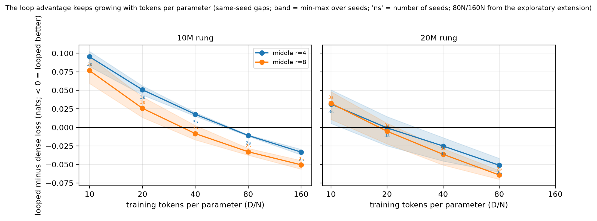
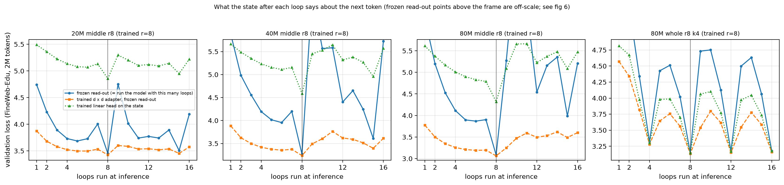
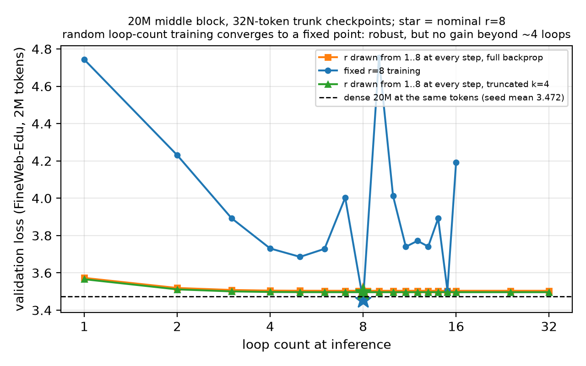
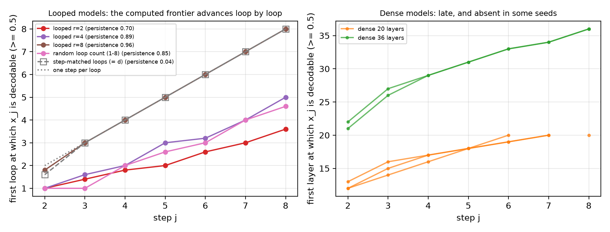

# 一次循环值多少？技术报告

> 本文是[英文技术报告](report.md)的中文版。文中链接的预注册、偏离记录、结果汇总等详细文档为英文。
> This is the Chinese version of the [technical report](report.md).


**循环 Transformer 从 10M 到 160M 参数的预注册 scaling 研究，以及对循环内部逐步推理的合成任务检验**

Qirun Li · 2026 年 10 月 · 草稿，结果截至 2026-10-12 · 代码、配置、日志和每一个数字：[github.com/bethehand/looped-scaling](https://github.com/bethehand/looped-scaling)

---

## 摘要

循环（递归深度）Transformer 把一个由若干层组成的块执行 *r* 次。它要付出这个块 *r* 倍的计算量，但不增加参数。我们测量了这样做能换来什么：用一个预注册的网格，共 111 次训练（10M–80M 的循环模型，作参照的普通模型最大到 160M，较小的尺寸各 3 个种子），外加三项延伸实验。

1. **在网页文本上，循环买到的是参数效率和数据效率，不是算力效率。** 参数和 token 数都相同时，中间块循环 4 次的模型在 10M 上比普通模型*差* 0.10 nats，到 160M 变为*好* 0.03–0.06 nats；而且优势随每参数训练 token 数的增加而持续扩大：每参数 token 数为 160 时，10M 的循环模型与用 1.7 倍 token 训练的普通模型持平。训练算力相同时，320 次比较中普通模型全部胜出。
2. **预注册的那个数 φ，在绝对值上不可辨识**，因为把损失换算成"等效参数"的普通模型尺子是弱可辨识的：主拟合给出各单元 φ = 0–0.17，联合拟合给出 0.29–0.41。它的趋势是稳健的：按尺寸分别拟合，φ 从 10M 时的负值升到 160M 时的约 0.65。
3. **四个预注册假设没有一个按原来的表述成立。** 截断反传没有降低 φ（它对整栈循环有帮助），φ 没有随 *r* 饱和，算力最优的是普通模型。
4. **在文本上，循环并不是在迭代逼近答案。** 用固定圈数训练时，它执行一个固定长度的程序，最后一圈是一次幅度很大的"转身"；用截断反传训练时，它学到一个周期性的循环；用随机圈数训练时（与 Huginn 相同），它收缩到一个不动点。三者在推理时多跑圈数都得不到任何收益。
5. **在需要串行步骤的任务上，循环确实能学会逐步推理。** 在查找表链上，循环模型学会每圈算一步，多给圈数时能解出比训练时更长的链。同深度的普通模型参数多达 4.4 倍，却一出训练范围就失败。循环能否学到这种可以延伸的算法取决于训练：在对普通模型最优的学习率下，同一结构在同样的步数内学得差得多，也不外推（这是学成了别的解法，还是只是学得慢，由补充实验 S2 检验）。

一句话：当任务需要、并且循环被训练成迭代时，把推理放进架构里是有效的；在普通文本上，任务很少需要它，剩下的是一个随规模和数据增长的参数效率收益。

---

## 1. 为什么做这项研究

循环 Transformer 把一个由若干层组成的块重复使用多次：例如 Universal Transformers，以及近来的 Huginn、Ouro 等。人们对它有两个期望。第一是**参数效率**：循环模型应当表现得像一个更大的普通模型；当限制部署的是显存或带宽而不是计算量时，这一点很重要。第二是**潜空间推理**：如果循环是在对一个问题反复迭代，那么测试时多跑几圈就应当能解更难的问题，而不需要写出思维链。

这两种说法都很难从已有文献中核实。各项研究的数据、分词器、训练配方和模型家族都不同；很少报告种子；而真正关心的那个量——多一圈值多少——通常是从单次拟合里读出来的。因此我们用同一套配方训练了一组受控的尺寸阶梯，在训练之前写下假设和分析方法（[预注册](preregistration.md)，2026-09-23 冻结），并记录了之后的每一处改动（[偏离记录](deviation-log.md)）。

## 2. 实验设置

| | |
|---|---|
| 模型尺寸 | 循环模型为 10M、20M、40M 和 80M（宽度 320 / 448 / 640 / 896，8 个独立层）；作参照的普通模型（"尺子"）另有 160M（宽度 1280）。N = 普通模型的非嵌入参数 + 输出头：15.4M / 26.8M / 50.2M / 92.7M / 179.6M |
| 循环单元 | **中间块**（2 层执行一次，4 层循环，2 层执行一次）或**整栈**（8 层全部循环）；r ∈ {2, 4, 8}；不截断，或在 r = 4、8 时截断反传、只穿过最后 r/2 圈 |
| 数据 | FineWeb-Edu sample-10BT（10.4B token，单 epoch，固定顺序），16k BPE 词表。考卷：留出的 FineWeb-Edu（主考卷）、SlimPajama、FineMath、代码 |
| 训练 | AdamW，WSD 调度，在每参数 token 数为 10、20 和 40 处分出冷却分支（普通模型：5–80）；学习率取自在普通模型上做的 33 次扫描；10M–40M 各 3 个种子，80M 1 个 |
| 测量 | N_eff = N_once + r^φ · N_rec，尺子 L(N, D) = E + A·N^−α + B·D^−β 在普通模型上拟合；对数空间的 Huber 损失，500 个随机起点，1000 次分块 bootstrap 重采样 |
| 算力 | 4× RTX 4090；主网格用了 11 天；延伸实验又用了约 5 天 |

四个预注册假设：**H1** 截断反传降低 φ（在等 token 和等 FLOP 两种口径下都如此）；**H2** 循环中间块的 φ 高于循环整栈；**H3** φ 随 *r* 饱和；**H4** 按训练算力计，算力最优的 *r* 较小，按部署算力计则更大。

## 3. 循环在文本上值多少

### 3.1 预注册假设的判定

| 假设 | 判定 |
|---|---|
| H1 截断降低 φ | 不支持。中间块 0.00 对 0.13（方向与预测一致，区间重叠）；整栈 0.17 对 0.00（方向相反）。等 FLOP 口径下相同。 |
| H2 中间块 > 整栈 | 依口径而异。φ 的结果不一；在执行深度相当时比较原始损失，24 次比较中 24 次偏向中间块。 |
| H3 随 r 饱和 | 不支持，方向相反：r^φ 形式在两个方向上外推到留出的尺寸都更准，AIC 也低 16。 |
| H4 算力最优的 r | 无论按训练算力还是部署算力，最优的都是普通模型（r = 1）。 |

途中有一个意外：**截断反传帮助了整栈循环**。在 20M、每参数 token 数为 10 时，整栈循环 4 次的模型截断时达到 3.645，不截断时为 3.789；在 10M 上，比普通模型好的循环单元只有 r = 8 的整栈循环。截断还带来了损失尖峰：111 次训练中有 30 次至少出现过一次，几乎都在截断或整栈单元里，另有一次训练崩溃。在一项后续实验中，把学习率减半后尖峰消失了。

### 3.2 为什么 φ 这个数还定不下来

φ 需要一把尺子：即用普通模型拟合出的那条公式，它告诉我们一定数量的参数能换来多低的损失。在我们五个普通模型尺寸上拟合时，尺子的不可约损失落在下界上，参数指数 α = 0.054，远低于常见的 0.3。五个尺寸无法把 E、A 和 α 分别定下来。对全部训练做联合拟合得到 α = 0.267，φ 大约翻了一倍（0.29–0.41，而不是 0–0.17）。预注册的 φ 值照原样报告（[结果汇总 §3](results.md)），但下面的结论建立在不需要尺子的量上。

### 3.3 价值随规模和数据增长

<p align="center"></p>

**规模。** 同一个单元（中间块循环 4 次）与同尺寸、同种子的普通模型比较（图 12）。在每参数 token 数为 40 时，从 10M 到 160M 的损失差依次为 +0.018、−0.025、−0.050、−0.055 和 −0.063 nats（负数 = 循环更好），并且在每个预算上曲线都是单调的。160M 的两个种子相差不到 0.001 nats。固定尺子、换算成 φ（探索性），同一单元依次为 −0.32、0.19、0.39、0.52、0.65。以损失计，增量在缩小（每翻一倍依次为 0.043、0.025、0.005、0.008），而 φ 不能超过 1，所以曲线一定会在某处弯下来；我们还看不到在哪里。

<p align="center"></p>

**数据。** 把已完成的 10M 和 20M 训练继续训到每参数 token 数 80 和 160（图 11），数据每翻一倍，中间块单元的优势就再增加 0.02–0.03 nats，没有饱和的迹象。如果换算成普通模型要追平循环模型所需的数据量，10M 中间块循环 8 次从每参数 token 数 10 时的 0.85× 升到 160 时的 1.68×（两个种子）；20M 的在 80 时达到 1.65×。整栈循环的方向相同。

**算力。** 把每次循环训练的训练算力换算成普通模型用同样算力能看到的 token 数，再从实测的普通模型曲线上读出普通模型的损失，结果 320 次比较中普通模型全部更好。差距随预算增大而缩小（80M 中间块 r = 4：每参数 token 数 10 时 +0.135 nats，40 时 +0.034），但从未消失。循环是用算力换参数和数据的办法，不是省算力的办法。

### 3.4 收益落在哪里

逐 token 看，网页文本上的收益是一个幅度小、范围广的整体下移：大约一半的 token 变好；收益集中在难 token 上的程度，不超过两个普通模型种子之间本来就有的差异。在数学和代码上，平均收益大 3–7 倍，但这两类考卷上种子之间的噪声也大 10–100 倍。

## 4. 循环块在文本上算的是什么

我们对训练好的模型逐圈做探针：在每一圈之后读取状态，分别用模型自己的输出层直接读（"原样读"，即 logit lens）、在输出层前面加一个训练过的线性变换再读，以及用一个训练过的线性头读。

<p align="center"></p>

- **固定圈数（r = 8）。** 加上训练过的线性变换后，第 4 圈之后的状态读出的损失已经与最终损失相差在 0.1–0.2 nats 以内，第 5–7 圈几乎没有再增加什么。最后一圈是一次幅度很大的非线性移动，把状态改写成输出层所期望的形式；37–44% 的 token 的预测直到这一圈才定型。推理时少跑或多跑圈数都会破坏模型（图 6）。这在 20M 和 40M 的不同种子上都复现了。
- **截断反传（整栈，k = 4）** 学到的是周期为 4 的循环：状态每 4 圈回到几乎同一个点，所以模型在 4、8、12 或 16 圈时都能工作，再多跑也没有任何收益。
- **训练时用随机圈数**（每一步从 1–8 中抽取 r，与 Huginn 相同）学到的是向不动点的收缩：推理圈数从 1 到 32，损失在约 4 圈之后都是平的。模型对圈数鲁棒，但在标称的 8 圈上比固定 r 训练差 0.05 nats，与普通模型打平。
- **学习率。** 在用普通模型学习率的 0.5×、0.71× 和 1× 训练的 20M 模型中，学习率越低，曲线随推理圈数的变化越平（更接近收敛的迭代）。在文本上，多于训练圈数的循环从来没有带来好处。

<p align="center"></p>

## 5. 循环能学会逐步推理吗？

文本很少给循环迭代的理由：预测下一个词很少需要许多串行步骤。因此我们构造了一个需要串行步骤的任务（[设计](synthetic-reasoning-design.md)，2026-10-09 冻结）。每道题给出一个起始值和一串查表操作，例如 `25 ; LUT 7 ; LUT 3 ; LUT 19 ; … =>`，其中每个 LUT 是 32 个定义在 0–96 上的固定随机函数之一；模型必须在一次前向计算中输出最终值。两次查表复合起来是 1024 种任意函数之一，所以处理长链的唯一办法是一步一步地算。模型在 1–8 步的题上训练，测试到 24 步。我们把 8、20 和 36 层的普通模型与一个 8 层的循环模型（执行 2 + 4×r + 2 层）比较，循环模型分别用 r = 2、4 或 8 圈训练，或用随机圈数训练，或用与链的步数一样多的圈数训练。每个条件都使用只按分布内准确率扫描选出的学习率，各有 5 个种子。

| 模型 | 参数量 | 能解的最大步数* | 推理时多给圈数 | 12 步准确率** | 16 步时** |
|---|---|---|---|---|---|
| 普通模型，8 层 | 6.5M | 4.2 (4–5) | — | 0.06 | 0.05 |
| 普通模型，20 层 | 16.1M | 6.4 (6–7) | — | 0.04 | 0.03 |
| 普通模型，36 层 | 29.0M | 8.0 (8–8) | — | 0.02 | 0.02 |
| 循环模型，r = 2 | 6.6M | 6.4 (6–7) | 6.4 (6–7) | 0.57 | 0.23 |
| 循环模型，r = 4 | 6.6M | 8.0 (8–8) | 11.8 (10–15) | 0.82 | 0.28 |
| 循环模型，r = 8 | 6.6M | 9.0 (9–9) | 11.2 (11–12) | 0.86 | 0.37 |
| 循环模型，随机圈数 | 6.6M | 11.4 (10–13) | 12.2 (10–15) | 0.83 | 0.49 |
| 循环模型，圈数 = 步数 | 6.6M | 12.8 (11–16) | — | 0.96 | 0.37 |

\* 在模型自身的圈数下，所有不超过它的链长都以 ≥ 90% 解出的最长链长，5 个种子的均值（最小–最大）。\*\* 可用圈数中最好的一个，对种子取平均。

<p align="center"></p>

**循环买到的是步数，而且在这里权重共享胜过额外的深度。** 参数相同时，圈数越多，能解的链越长（4.2 → 6.4 → 8.0 → 9.0 步）。执行深度相同的普通模型参数是循环模型的 2.4–4.4 倍，却更差，而且一出训练范围就失败；在 12 步时它们处于随机水平，而循环模型达到 0.57–0.96。

**推理时多跑圈数能解更长的链**（图 14）。用 8 圈训练的模型在 8 圈时能解 9 步，在 16 或 32 圈时能解约 11 步。这个收益是真实的，但有上限：在 16 步时为 0.37。

<p align="center"></p>

**探针显示每圈算一步**（图 15）。在每一圈之后，我们针对每个中间值 x_j，在输入中属于它自己的位置上训练一个线性探针。在用 8 圈训练的模型中，x_j 大约在第 j 圈出现（x_8 在第 8 圈；5 个种子都是每步 1.0–1.1 圈），而且每个值之后一直可以解码（保持度 0.96）。用圈数 = 步数训练的模型也是每圈算一步，但会在下一圈把每个值覆盖掉（保持度 0.04），所以它只在恰好 d 圈时才工作。用较少圈数训练的模型把更多的步塞进每一圈（r = 4 时每圈约 1.6 步，r = 2 时约 2.4 步），刚好够覆盖训练范围。普通模型算得晚，36 层中大约从第 21 层开始；而且在几个种子中，中间值根本没有出现在各步的位置上。

**训练决定循环学到哪种算法。** 上面所有循环模型都是用 1.25e-4–2.5e-4 的学习率训练的，比为普通模型选出的学习率（5e-4–1e-3）低 2–8 倍。在学习率扫描中（种子 1），同样的 r = 8 结构在 1e-3 下只在恰好 8 圈时工作，没有逐步推进的前沿，和第 4 节的语言模型一样；但它在训练范围内也学得差得多（同样 16000 步后准确率 0.54，2.5e-4 时为 0.999），所以可能只是学得慢。补充实验 S2（[方案](supplementary-experiments.md)）把循环条件在 5e-4 和 1e-3 下用 3 个种子完整训练 32000 步，来区分这两种解释。对扫描的全部存档（种子 1）做探针，看到同样的分化：对循环 r = 8，学习率不超过 5e-4 时有逐步推进的前沿（大约每圈一步），1e-3 和 2e-3 时没有，此时中间值在各步的位置上始终无法解码；循环 r = 4 和随机圈数模型的表现相同。外推跟着前沿走：多给圈数后，r = 8 在两个最低的学习率下能解 10–11 步，在 1e-3 下为 3 步。

**对照预注册的预测**（[结果汇总 §5.15](results.md)）：P1（参数相同时，圈数越多，能解的步数越多）方向成立，但 r = 8 没有达到 16 步；P2（同深度普通模型至少一样好）结果相反；P3（推理时扩展）部分成立——固定 r 的模型*没有*因为多跑圈数而变差；P4（只有圈数 = 步数的模型每圈算一步）对了一半——固定 r 的模型也是如此，真正的区别在于保持度；P5（差距比文本上大得多）成立。

## 6. 实用结论

- **当约束是参数、显存或数据，而不是算力时，使用循环。** 同参数下的优势随模型大小和每参数 token 数增长；同算力下普通模型更好。中间块循环 r = 2、4、8 圈，每 token 的训练 FLOP 分别是同尺寸普通模型的 1.4–1.5 倍、2.2–2.4 倍、3.7–4.1 倍。
- **循环中间块，并且不截断反传。** 在执行深度相当时，中间块循环在每一次比较中都胜过整栈循环。30 个出现过损失尖峰的任务里，25 个用了截断反传（其中 16 个是整栈循环）；在 10M 的补充实验里，把学习率减半就消除了尖峰。
- **在文本上先用 r = 4，并在目标规模上评估。** 在 40M–80M，r = 8 的效果与 r = 4 差不多，但计算量约多 1.7 倍。一次循环在更大的模型、更多的每参数 token 数下更值钱，所以小规模的消融实验会低估它。
- **不要指望在文本上得到测试时扩展。** 固定圈数训练得到的模型只在训练时的圈数下工作；随机圈数训练让模型对圈数鲁棒，但多跑圈数也不会更好。
- **对需要逐步计算的任务，要单独调循环模型的学习率**，可能要比普通模型的低好几倍，并用推理圈数扫描（或探针）检查它学到的是哪种算法：只在训练圈数下工作的模型学到的是固定程序；多跑圈数时准确率保持或上升的模型才是在迭代。
- **显存和延迟要自己测。** 本研究报告的是损失和 FLOP，没有测部署速度，而部署速度往往正是使用循环的初衷。

## 7. 出了哪些问题，我们改了什么

下面每一项在[偏离记录](deviation-log.md)里都有日期。

- 训练机器的**两次电源故障**（2026-09-24 和 2026-10-07）让 CPU 慢了约 30 倍；训练从存档恢复，没有任何结果受到影响。
- **超参数沿用普通模型的。** 预注册的循环单元学习率检查（20M，普通模型学习率的 0.5–1×，10N）没有找到更好的学习率，但 10 个单元中有 9 个在所试范围的上沿最好，而且检查没有覆盖更长的预算和其他规模。在合成任务上，循环模型的最佳学习率比普通模型的低 2–8 倍。补充实验 S1（[方案](supplementary-experiments.md)）在 10M–40M 上、到 40N 为止的每个预算（10M 到 160N），为普通模型和循环模型都重新调学习率。
- **合成任务在正式运行之前改了两次。** 模运算链在各种长度平均混合的数据上学不会（于是加了课程式喂题），之后仍然学得很慢，所以把运算换成了固定的查找表。两次改动都发生在任何条件之间的比较之前。
- **学习率的选择标准饱和了。** 有几个循环条件在两三个学习率下的分布内成绩都约为 0.999；平局时按实现取了最低的学习率，而协议没有规定这一点，后来发现外推对这个选择很敏感。
- **去掉了指针追踪对照。** 它从未做过预试；在按链任务校准的配方下，没有任何条件连单跳都学会。
- **第一版探针每步只读一个位置**，漏掉了某个种子存放在别处的中间值；现在每步读三个位置，取最好的一个。
- **一个未解释的异常：** 在 160M、每参数 token 数为 40 时，一个循环模型种子在分布外考卷上比另一个差 0.2–0.6 nats，而两者在主考卷上的损失相同。

## 8. 局限

- 规模：10M–160M 参数、16k 词表，远小于部署循环语言模型时的 1B+ 规模。scaling 趋势可能会弯折；我们有五个尺寸，80M 只有一个种子，160M 只有一个循环单元。
- 一个数据来源（FineWeb-Edu），单 epoch；没有覆盖多 epoch 的情形，而循环在那里可能更重要。
- 算力按 FLOP 计；我们没有测量显存或解码延迟，而这些正是实践者使用循环的原因。
- 合成任务的证据来自一个任务族和 6.6M 参数的模型；外推长度在种子之间差别很大。

## 9. 复现

```
cd code
uv venv --python 3.11 && source .venv/bin/activate && uv pip install -e .
python -m pytest tests -q
```

[code/README.md](../code/README.md) 列出了完整的步骤：数据准备、学习率扫描、主网格、拟合、延伸实验和作图。每次训练的结果和训练日志在 `code/results/`，拟合结果在 `code/results/fit/`，合成任务的结果在 `code/results/synthetic/`，所有图都由 `code/fit/make_figures.py` 和 `code/synthetic/analyze.py` 生成。
